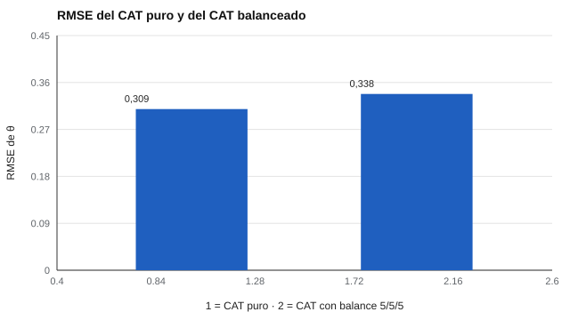

# 185 — Evaluación adaptativa: implementación


<!-- NAV -->
[← 184 — Telemetría de interacción y tiempos de respue…](../184-telemetria-de-interaccion-y-tiempos-de-respuesta/README.md) · [📚 Parte 18](../README.md) · [🗺️ Índice 001–200](../../../PROGRAMA.md) · [186 — Accesibilidad de evaluaciones digitales →](../186-accesibilidad-de-evaluaciones-digitales/README.md)
<!-- /NAV -->

**Parte 18 — Ingeniería de sistemas de evaluación digital** · Nivel avanzado · 5 h · Estado `escrita`
**Pensada para:** quien implementa o evalúa un test adaptativo, y quien lo rinde.
**Prerrequisitos:** clase 184.

> Banco y examinados sintéticos.

## ¿Para qué te sirve esto?

Un test adaptativo (CAT) elige, en cada paso, el ítem más informativo para el nivel estimado de la persona. Es eficiente: con 15 ítems alcanza precisión que un test fijo logra con muchos más. Pero hay un problema: si solo se busca precisión, **el algoritmo puede concentrar el test en el área donde el banco tiene los ítems más informativos**. Con 15 ítems, el 98 % pueden ser de una sola área, y entonces el test ya no mide el constructo que se definió. Esta clase te muestra el costo de precisión de **balancear contenido** y por qué esa elección es de validez, no solo estadística.

## Al terminar esta clase podrás

- Implementar un CAT con restricciones de contenido.
- Medir el costo de precisión del balance.
- Justificar el balance como decisión de validez.

## La idea en palabras simples

Un CAT elige el ítem de mayor información en la estimación actual (clase 059). Sin restricciones puede concentrar el test en el área más informativa. Las **cuotas de contenido** resguardan la validez de contenido a costa de algo de precisión (van der Linden y Glas, 2010; Embretson y Reise, 2000, sobre TRI). Además se controla la **exposición** de ítems (clase 060).

## Cómo funciona, paso a paso

**1. Simular** un banco de 240 ítems 2PL en 3 áreas y 150 examinados.

**2. Aplicar** un CAT puro y uno con cuotas 5/5/5 en 15 ítems.

**3. Comparar** el RMSE de θ y la distribución de ítems por área.

**Ejemplo resuelto.** El CAT puro es más preciso, pero un test con 14,7 de 15 ítems de una sola área no mide el constructo definido. Se prefiere el balanceado aunque pierda 0,03 de RMSE.



*Figura 1.* Equilibrar el contenido cuesta 0,03 de RMSE.

## Si construyes el instrumento

- Define las cuotas de contenido desde el plano de especificaciones.
- Controla la exposición de ítems.
- Justifica el balance como decisión de validez.
- Declara el costo de precisión.

## Si eres evaluado

- Dos personas pueden responder ítems distintos y aun así ser comparables.
- Pregunta si el test cubre todas las áreas que dice medir.

## Qué muestra el laboratorio

| Estrategia | RMSE θ | Ítems por área (media) | % tests con un área > 8 |
|---|---:|---|---:|
| CAT puro | 0,309 | [0,0; 0,3; 14,7] | 100 % |
| CAT con balance 5/5/5 | 0,338 | [5,0; 5,0; 5,0] | 0 % |

**Análisis.** (1) El CAT puro concentra los ítems en el área más informativa (la 3), lo que compromete la representatividad. (2) El balance garantiza cobertura al costo de algo de precisión. (3) La elección es de validez, no solo estadística. (4) Además se controla la exposición.

## Errores frecuentes

- Optimizar solo la precisión.
- Olvidar la exposición de ítems.
- No declarar el costo del balance.
- Usar un banco con áreas desbalanceadas en información.

## Lo mínimo que debes llevarte

1. El CAT elige el ítem más informativo.
2. Sin restricciones puede concentrarse en un área.
3. Las cuotas protegen la validez de contenido.
4. El balance tiene un costo de precisión.

## Ejercicios

- **Inicial.** ¿Por qué se limita cada área a un tercio? *Solución: para que el test represente todas las áreas del constructo.*
- **Intermedio.** Cambia el largo del test a 21 y observa el RMSE.
- **Avanzado.** Propón una restricción adicional de exposición máxima.
- **Aplicación.** Define las cuotas de un CAT de 20 ítems para un constructo con 4 áreas desiguales.

## Glosario

- **CAT:** test adaptativo computarizado.
- **Cuota de contenido:** número fijo de ítems por área.
- **RMSE:** error típico de estimación de θ.
- **Exposición:** frecuencia con que se administra un ítem.

## Laboratorio

```bash
python classes/part-18-ingenieria-de-sistemas-de-evaluacion-digital/185-evaluacion-adaptativa-implementacion/lab.py
python classes/part-18-ingenieria-de-sistemas-de-evaluacion-digital/figuras.py
```

## Autoevaluación y criterios

1. ¿Qué parte del diseño podría fallar sin que nadie lo note? 2. ¿Qué evidencia guardarías? 3. ¿Qué dato no deberías conservar?
Se logra la clase si implementas la idea, la pruebas con datos sintéticos y declaras sus límites.

## Bibliografía

- van der Linden, W. J., & Glas, C. A. W. (Eds.) (2010). *Elements of Adaptive Testing*. Springer. ✅ [DOI](https://doi.org/10.1007/978-0-387-85461-8)
- Embretson, S. E., & Reise, S. P. (2000). *Item Response Theory for Psychologists*. Lawrence Erlbaum. 🔎 sin verificar (libro, norma o sitio no hallado en Crossref: comprobar a mano)

Leyenda: ✅ existe en Crossref con título y año coincidentes (enlace al DOI); ⚠️ hay una obra de título parecido con otro año (no se enlaza: comprobar la edición); 🔎 no verificada automáticamente (libros sin DOI, normas y sitios web). Crossref confirma la existencia de la fuente, no que respalde cada afirmación de la clase. Ver [`docs/VERIFICACION_BIBLIOGRAFIA.md`](../../../docs/VERIFICACION_BIBLIOGRAFIA.md).

---

<!-- NAV -->
[← 184 — Telemetría de interacción y tiempos de respue…](../184-telemetria-de-interaccion-y-tiempos-de-respuesta/README.md)  
[📚 Parte 18](../README.md) · [🗺️ Índice 001–200](../../../PROGRAMA.md)  
[186 — Accesibilidad de evaluaciones digitales →](../186-accesibilidad-de-evaluaciones-digitales/README.md)
<!-- /NAV -->
