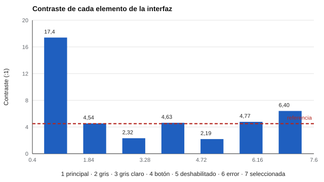

# 186 — Accesibilidad de evaluaciones digitales


<!-- NAV -->
[← 185 — Evaluación adaptativa: implementación](../185-evaluacion-adaptativa-implementacion/README.md) · [📚 Parte 18](../README.md) · [🗺️ Índice 001–200](../../../PROGRAMA.md) · [187 — Auditoría de cálculo y trazabilidad →](../187-auditoria-de-calculo-y-trazabilidad/README.md)
<!-- /NAV -->

**Parte 18 — Ingeniería de sistemas de evaluación digital** · Nivel avanzado · 5 h · Estado `escrita`
**Pensada para:** quien diseña interfaces de evaluación, y quien las usa con distintas necesidades de acceso.
**Prerrequisitos:** clase 185.

> La verificación automática del color es solo una parte de la accesibilidad.

## ¿Para qué te sirve esto?

Un gris claro sobre blanco «se ve bien» para quien lo diseñó, pero puede ser casi ilegible para alguien con baja visión. Si una persona no puede leer un ítem, su puntaje mide la **barrera**, no el constructo. La accesibilidad es, por eso, un asunto de **validez**: una barrera de acceso introduce varianza irrelevante al constructo (AERA et al., 2014). Esta clase te enseña a calcular la relación de contraste de las pautas WCAG y a separar lo que se puede verificar automáticamente de lo que exige pruebas con usuarios.

## Al terminar esta clase podrás

- Calcular la relación de contraste WCAG.
- Distinguir lo verificable automáticamente de lo que exige usuarios.
- Relacionar accesibilidad con validez.

## La idea en palabras simples

Las pautas **WCAG 2.x** (W3C) fijan relaciones de contraste mínimas para el nivel AA: **4,5:1** para texto normal y **3:1** para texto grande y componentes de interfaz. La relación se calcula a partir de la luminancia relativa de los dos colores: (L_claro + 0,05) / (L_oscuro + 0,05). Lo automático cubre el color; lo demás (teclado, lectores de pantalla, tiempos ajustables, lenguaje claro, descripción de imágenes) exige pruebas específicas y usuarios.

## Cómo funciona, paso a paso

**1. Verificar** el cálculo con negro sobre blanco (debe dar 21:1).

**2. Calcular** el contraste de cada par de colores de la interfaz.

**3. Comparar** con 4,5:1 y 3:1, y corregir lo que no cumpla.

**Ejemplo resuelto.** Un gris #aaaaaa sobre blanco parece legible para quien tiene visión típica, pero con 2,32:1 no cumple AA; se oscurece hasta superar 4,5:1.



*Figura 1.* Dos de siete elementos no cumplen el mínimo.

## Si construyes el instrumento

- Incluye la verificación de contraste en el CI de la interfaz.
- Prueba con teclado, lector de pantalla y tiempos ajustables.
- Usa lenguaje claro y describe las imágenes.
- No excluyas ajustes razonables por «estandarización».

## Si eres evaluado

- Tienes derecho a pedir ajustes razonables para rendir la evaluación.
- Si no puedes leer o manejar la interfaz, avisa: tu puntaje no debería medir esa barrera.

## Qué muestra el laboratorio

Verificación: negro sobre blanco = 21,0:1.

| Elemento | Texto | Fondo | Contraste | AA normal | AA grande/UI |
|---|---|---|---:|---|---|
| Texto principal | #1a1a1a | #ffffff | 17,40:1 | sí | sí |
| Texto secundario gris | #767676 | #ffffff | 4,54:1 | sí | sí |
| Texto gris claro | #aaaaaa | #ffffff | 2,32:1 | NO | NO |
| Botón primario | #ffffff | #1f6feb | 4,63:1 | sí | sí |
| Botón deshabilitado | #9aa0a6 | #e8eaed | 2,19:1 | NO | NO |
| Error en rojo | #d93025 | #ffffff | 4,77:1 | sí | sí |
| Opción seleccionada | #ffffff | #5b2eff | 6,40:1 | sí | sí |

**Análisis.** (1) Un gris que «se ve bien» al diseñador puede no cumplir el contraste para quien tiene baja visión. (2) La verificación del color es barata y se incluye en el CI. (3) El resto se verifica con pruebas específicas y usuarios. (4) Una evaluación inaccesible mide la barrera, no el constructo.

## Errores frecuentes

- Creer que el contraste agota la accesibilidad.
- No probar con lectores de pantalla, teclado y tiempos ajustables.
- Excluir ajustes razonables por «estandarización».
- Ignorar el estado deshabilitado de los botones.

## Lo mínimo que debes llevarte

1. AA exige 4,5:1 para texto normal y 3:1 para texto grande y UI.
2. El color se verifica automáticamente.
3. Lo demás exige pruebas con usuarios.
4. La accesibilidad es una condición de validez.

## Ejercicios

- **Inicial.** ¿Cuál es el contraste mínimo AA para texto normal? *Solución: 4,5:1.*
- **Intermedio.** Busca un gris que quede justo sobre 4,5:1. *Solución: por ejemplo #767676 sobre blanco (4,54:1).*
- **Avanzado.** Elabora una lista de verificación de accesibilidad para una evaluación en línea.
- **Aplicación.** Revisa los colores de una página que uses y calcula el contraste de tres pares.

## Glosario

- **WCAG:** pautas de accesibilidad web del W3C.
- **Contraste:** relación entre la luminancia de dos colores.
- **Nivel AA:** nivel intermedio de conformidad de las WCAG.
- **Varianza irrelevante al constructo:** diferencia de puntajes por factores ajenos a lo que se mide.

## Laboratorio

```bash
python classes/part-18-ingenieria-de-sistemas-de-evaluacion-digital/186-accesibilidad-de-evaluaciones-digitales/lab.py
python classes/part-18-ingenieria-de-sistemas-de-evaluacion-digital/figuras.py
```

## Autoevaluación y criterios

1. ¿Qué parte del diseño podría fallar sin que nadie lo note? 2. ¿Qué evidencia guardarías? 3. ¿Qué dato no deberías conservar?
Se logra la clase si implementas la idea, la pruebas con datos sintéticos y declaras sus límites.

## Bibliografía

- W3C. *Web Content Accessibility Guidelines (WCAG) 2.x*. w3.org/TR/WCAG2. 🔎 sin verificar (libro, norma o sitio no hallado en Crossref: comprobar a mano)
- AERA, APA, & NCME (2014). *Standards for Educational and Psychological Testing*. AERA. 🔎 sin verificar (libro, norma o sitio no hallado en Crossref: comprobar a mano)

Leyenda: ✅ existe en Crossref con título y año coincidentes (enlace al DOI); ⚠️ hay una obra de título parecido con otro año (no se enlaza: comprobar la edición); 🔎 no verificada automáticamente (libros sin DOI, normas y sitios web). Crossref confirma la existencia de la fuente, no que respalde cada afirmación de la clase. Ver [`docs/VERIFICACION_BIBLIOGRAFIA.md`](../../../docs/VERIFICACION_BIBLIOGRAFIA.md).

---

<!-- NAV -->
[← 185 — Evaluación adaptativa: implementación](../185-evaluacion-adaptativa-implementacion/README.md)  
[📚 Parte 18](../README.md) · [🗺️ Índice 001–200](../../../PROGRAMA.md)  
[187 — Auditoría de cálculo y trazabilidad →](../187-auditoria-de-calculo-y-trazabilidad/README.md)
<!-- /NAV -->
