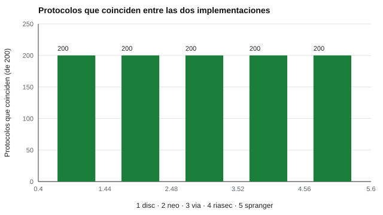

# 187 — Auditoría de cálculo y trazabilidad


<!-- NAV -->
[← 186 — Accesibilidad de evaluaciones digitales](../186-accesibilidad-de-evaluaciones-digitales/README.md) · [📚 Parte 18](../README.md) · [🗺️ Índice 001–200](../../../PROGRAMA.md) · [188 — Seguridad y privacidad por diseño →](../188-seguridad-y-privacidad-por-diseno/README.md)
<!-- /NAV -->

**Parte 18 — Ingeniería de sistemas de evaluación digital** · Nivel avanzado · 5 h · Estado `escrita`
**Pensada para:** quien debe poder justificar un puntaje, y quien quiere cuestionar el suyo.
**Prerrequisitos:** clase 186.

> La coincidencia prueba consistencia, no validez.

## ¿Para qué te sirve esto?

Alguien dice: «mi puntaje está mal». ¿Cómo se comprueba? Si el sistema calculó con una versión que ya no existe y no dejó registro, no hay forma. Esta clase te enseña dos ideas para poder **auditar** un cálculo: (1) **verificar el motor con una segunda implementación independiente**: si dos programas escritos por separado coinciden en miles de casos, es muy improbable que compartan el mismo error; (2) dejar un **registro reproducible** con la versión del instrumento y huellas de la entrada y la salida, sin guardar las respuestas en claro.

## Al terminar esta clase podrás

- Verificar el motor con una segunda implementación.
- Generar un registro de auditoría reproducible.
- Entender los límites del *differential testing*.

## La idea en palabras simples

Si dos implementaciones independientes coinciden en muchos casos, es improbable que compartan el mismo error (McKeeman, 1998: *differential testing*). Un **registro de auditoría** con la versión del instrumento y las huellas de entrada y salida permite **reproducir** un puntaje sin exponer las respuestas. El límite: si ambas implementaciones parten de la misma mala interpretación del manual, coincidirán y estarán mal.

## Cómo funciona, paso a paso

**1. Implementar** la puntuación dos veces, de forma independiente.

**2. Generar** 200 protocolos aleatorios por instrumento y comparar.

**3. Registrar** instrumento, versión, huella de entrada y huella de salida.

**Ejemplo resuelto.** Un puntaje cuestionado se audita recalculando con la versión registrada y comparando la huella de salida.



*Figura 1.* Las dos implementaciones coinciden en los 1 000 protocolos.

## Si construyes el instrumento

- Prueba casos extremos, no solo los típicos.
- Mantén una segunda implementación independiente, escrita desde el manual.
- Registra versión y huellas, no respuestas en claro.
- Recuerda que esto prueba consistencia, no validez.

## Si eres evaluado

- Tienes derecho a pedir que se verifique el cálculo de tu puntaje.
- Un sistema auditable debería poder reproducirlo con la versión registrada.

## Qué muestra el laboratorio

| Instrumento | Protocolos | Coinciden | Versión |
|---|---:|---:|---|
| disc-abierto | 200 | 200 | 0.1.0 |
| ipip-neo-120 | 200 | 200 | 1.0.0 |
| ipip-via-r | 200 | 200 | 1.0.0 |
| onet-riasec-sf | 200 | 200 | 1.0.0 |
| valores-spranger | 200 | 200 | 0.1.0 |

Cada fila va acompañada de un registro con huellas de entrada y salida.

**Análisis.** (1) Cuando dos implementaciones independientes coinciden en miles de casos, es muy poco probable que compartan un error. (2) El registro permite reproducir y auditar cualquier puntaje sin guardar las respuestas en claro. (3) La coincidencia prueba consistencia, no validez. (4) Los protocolos son aleatorios, no representan personas reales.

## Errores frecuentes

- Probar solo casos típicos.
- Que ambas implementaciones compartan una mala interpretación del manual.
- Guardar respuestas en claro en el registro.
- Confundir consistencia con validez.

## Lo mínimo que debes llevarte

1. Dos implementaciones independientes reducen el riesgo de error compartido.
2. El registro lleva versión y huellas.
3. Se audita recalculando con la versión registrada.
4. Coincidir no es ser válido.

## Ejercicios

- **Inicial.** ¿Qué es una segunda implementación independiente? *Solución: un programa escrito por separado, a partir de la misma especificación, que calcula lo mismo.*
- **Intermedio.** Introduce un error deliberado y comprueba que se detecta.
- **Avanzado.** Diseña un registro de auditoría para una batería.
- **Aplicación.** Escribe el procedimiento para atender un reclamo de «mi puntaje está mal».

## Glosario

- **Differential testing:** comparar dos implementaciones sobre las mismas entradas.
- **Registro de auditoría:** constancia reproducible de un cálculo.
- **Huella:** resumen criptográfico de un contenido.
- **Trazabilidad:** posibilidad de reconstruir cómo se obtuvo un resultado.

## Laboratorio

```bash
python classes/part-18-ingenieria-de-sistemas-de-evaluacion-digital/187-auditoria-de-calculo-y-trazabilidad/lab.py
python classes/part-18-ingenieria-de-sistemas-de-evaluacion-digital/figuras.py
```

## Autoevaluación y criterios

1. ¿Qué parte del diseño podría fallar sin que nadie lo note? 2. ¿Qué evidencia guardarías? 3. ¿Qué dato no deberías conservar?
Se logra la clase si implementas la idea, la pruebas con datos sintéticos y declaras sus límites.

## Bibliografía

- McKeeman, W. M. (1998). Differential testing for software. *Digital Technical Journal*, 10(1), 100-107.
- AERA, APA, & NCME (2014). *Standards for Educational and Psychological Testing*. AERA.

---

<!-- NAV -->
[← 186 — Accesibilidad de evaluaciones digitales](../186-accesibilidad-de-evaluaciones-digitales/README.md)  
[📚 Parte 18](../README.md) · [🗺️ Índice 001–200](../../../PROGRAMA.md)  
[188 — Seguridad y privacidad por diseño →](../188-seguridad-y-privacidad-por-diseno/README.md)
<!-- /NAV -->
