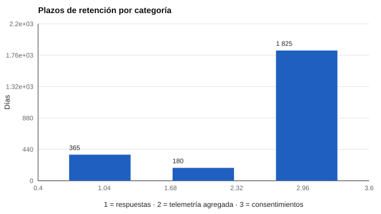

# 188 — Seguridad y privacidad por diseño


<!-- NAV -->
[← 187 — Auditoría de cálculo y trazabilidad](../187-auditoria-de-calculo-y-trazabilidad/README.md) · [📚 Parte 18](../README.md) · [🗺️ Índice 001–200](../../../PROGRAMA.md) · [189 — Interoperabilidad y exportación de resultados →](../189-interoperabilidad-y-exportacion-de-resultados/README.md)
<!-- /NAV -->

**Parte 18 — Ingeniería de sistemas de evaluación digital** · Nivel avanzado · 5 h · Estado `escrita`
**Pensada para:** quien diseña el almacenamiento de datos de evaluación, y quien entrega sus datos a un sistema.
**Prerrequisitos:** clase 187.

> Material educativo, no asesoría jurídica. La clave del laboratorio es de demostración. Los plazos reales se fijan según la finalidad y la normativa vigente (Ley 19.628 y Ley 21.719; verifica en bcn.cl).

## ¿Para qué te sirve esto?

Para separar los resultados de la identidad se suele reemplazar el RUT o el correo por un código. Muchas personas usan un **hash simple** (por ejemplo SHA-256 del identificador), pensando que no se puede revertir. Pero si los identificadores posibles son pocos o conocidos, **un atacante los prueba todos y recupera a la persona**. La solución es un **HMAC con clave secreta guardada aparte**. Esta clase te lo muestra con 1 000 identificadores ficticios y añade una segunda idea de diseño: **retención por categoría**, es decir, borrar lo que ya no se necesita.

## Al terminar esta clase podrás

- Seudonimizar con HMAC en lugar de un hash simple.
- Aplicar retención por categoría.
- Reconocer que esto no es asesoría jurídica.

## La idea en palabras simples

Un hash simple de un identificador acotado puede revertirse probando todos los candidatos; un **HMAC** (Krawczyk et al., 1997, RFC 2104) con clave secreta guardada aparte lo impide. La **privacidad por diseño** integra **minimización**, **seudonimización** y **plazos de retención** desde el origen. La eliminación incluye las copias de seguridad.

## Cómo funciona, paso a paso

**1. Intentar** revertir un hash simple con la lista de identificadores.

**2. Intentar** el mismo ataque contra un HMAC sin la clave.

**3. Aplicar** una política de retención por categoría y decidir qué se conserva y qué se elimina.

**Ejemplo resuelto.** Se guardan los resultados con el seudónimo HMAC y la clave en un gestor aparte; la telemetría detallada no se conserva.



*Figura 1.* Cada categoría de datos tiene su propio plazo.

## Si construyes el instrumento

- Usa HMAC y guarda la clave fuera del conjunto de datos.
- Rota la clave con un procedimiento.
- Fija plazos de retención por categoría y elimina también las copias.
- Minimiza: no recojas lo que no necesitas.

## Si eres evaluado

- Pregunta cómo se seudonimizan tus datos y cuánto tiempo se conservan.
- Tienes derechos sobre tus datos personales; consulta la normativa vigente.

## Qué muestra el laboratorio

| Prueba | Resultado |
|---|---|
| Hash simple: el atacante con la lista recupera a la persona | Sí |
| HMAC: el mismo ataque sin la clave | No |
| HMAC estable con la clave; cambia con otra clave | Sí / Sí |

Política de retención (días): respuestas 365, telemetría agregada 180, consentimientos 1 825.

| Categoría | Antigüedad (días) | Decisión |
|---|---:|---|
| Respuestas | 100 | conservar |
| Telemetría agregada | 30 | conservar |
| Consentimientos | 1 000 | conservar |
| Respuestas | 400 | eliminar |
| Telemetría agregada | 200 | eliminar |

**Análisis.** (1) Seudonimizar con HMAC separa los resultados de la identidad. (2) La clave se guarda fuera del conjunto de datos y se rota con un procedimiento. (3) Los plazos se fijan según la finalidad y la normativa vigente. (4) La eliminación incluye copias de seguridad.

## Errores frecuentes

- Guardar la clave junto con los datos.
- Olvidar copias de seguridad al eliminar.
- Usar hash simple sobre identificadores acotados.
- Fijar plazos sin considerar finalidad y normativa.

## Lo mínimo que debes llevarte

1. Un hash simple se revierte probando candidatos.
2. Un HMAC con clave secreta no.
3. La clave se guarda aparte y se rota.
4. La retención se fija por categoría.

## Ejercicios

- **Inicial.** ¿Por qué un HMAC es mejor que un hash simple? *Solución: porque sin la clave secreta no se puede probar candidatos para revertirlo.*
- **Intermedio.** Propón un procedimiento de rotación de clave.
- **Avanzado.** Redacta una política de retención para tres categorías de datos.
- **Aplicación.** Dibuja dónde guardarías datos, clave y copias de seguridad en un sistema de evaluación.

## Glosario

- **Seudonimización:** reemplazar identificadores por códigos reversibles solo con información adicional.
- **HMAC:** código de autenticación de mensajes con clave.
- **Retención:** plazo durante el cual se conservan los datos.
- **Minimización:** recoger y conservar solo lo necesario.

## Laboratorio

```bash
python classes/part-18-ingenieria-de-sistemas-de-evaluacion-digital/188-seguridad-y-privacidad-por-diseno/lab.py
python classes/part-18-ingenieria-de-sistemas-de-evaluacion-digital/figuras.py
```

## Autoevaluación y criterios

1. ¿Qué parte del diseño podría fallar sin que nadie lo note? 2. ¿Qué evidencia guardarías? 3. ¿Qué dato no deberías conservar?
Se logra la clase si implementas la idea, la pruebas con datos sintéticos y declaras sus límites.

## Bibliografía

- Krawczyk, H., Bellare, M., & Canetti, R. (1997). *HMAC: Keyed-Hashing for Message Authentication*. RFC 2104. [DOI](https://doi.org/10.17487/rfc2104)
- Ley 19.628 y Ley 21.719 (Chile): verificar el texto vigente en bcn.cl.

---

<!-- NAV -->
[← 187 — Auditoría de cálculo y trazabilidad](../187-auditoria-de-calculo-y-trazabilidad/README.md)  
[📚 Parte 18](../README.md) · [🗺️ Índice 001–200](../../../PROGRAMA.md)  
[189 — Interoperabilidad y exportación de resultados →](../189-interoperabilidad-y-exportacion-de-resultados/README.md)
<!-- /NAV -->
