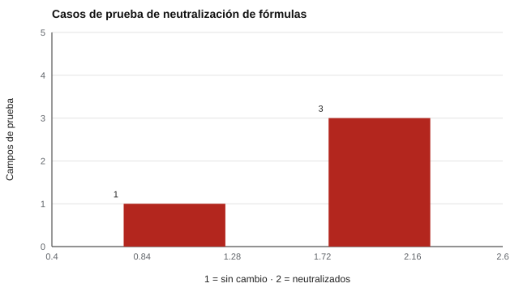

# 189 — Interoperabilidad y exportación de resultados


<!-- NAV -->
[← 188 — Seguridad y privacidad por diseño](../188-seguridad-y-privacidad-por-diseno/README.md) · [📚 Parte 18](../README.md) · [🗺️ Índice 001–200](../../../PROGRAMA.md) · [190 — Herramientas abiertas: jsPsych, PsychoPy, lab… →](../190-herramientas-abiertas-jspsych-psychopy-lab-js-pebl/README.md)
<!-- /NAV -->

**Parte 18 — Ingeniería de sistemas de evaluación digital** · Nivel avanzado · 5 h · Estado `escrita`
**Pensada para:** quien exporta resultados para análisis, y quien recibe archivos de resultados.
**Prerrequisitos:** clase 188.

> Los datos son sintéticos.

## ¿Para qué te sirve esto?

Un sistema de evaluación que no puede entregar sus datos a otras herramientas es una isla. Pero exportar bien tiene dos exigencias. Primera: el **formato** debe ser el que aceptan casi todas las herramientas de análisis (una fila por persona y escala) e incluir **versión y licencia** para que el cálculo sea reproducible. Segunda: un archivo CSV **no es inocente**: un texto que empieza con `=`, `+`, `-` o `@` puede ejecutarse como fórmula al abrirlo en una planilla. Esta clase te enseña ambas cosas.

## Al terminar esta clase podrás

- Exportar en formato largo con metadatos.
- Verificar la ida y vuelta.
- Neutralizar la inyección de fórmulas en CSV.

## La idea en palabras simples

El **formato largo** (una fila por persona y escala) es aceptado por la mayoría de las herramientas de análisis. Incluir **versión, licencia y número de ítems respondidos** hace reproducible el cálculo (principios FAIR; Wilkinson et al., 2016). Un campo que empieza con `=`, `+`, `-` o `@` puede interpretarse como fórmula en una planilla (OWASP, *CSV Injection*): se **neutraliza** anteponiendo un apóstrofo para que se muestre como texto.

## Cómo funciona, paso a paso

**1. Exportar** 3 personas × 6 escalas = 18 filas, con metadatos.

**2. Verificar** la ida y vuelta: leer el CSV debe reproducir los datos.

**3. Neutralizar** los campos de texto libre antes de escribirlos.

**Ejemplo resuelto.** Un nombre de participante `=HYPERLINK(...)` se exporta con un apóstrofo delante y se muestra como texto.



*Figura 1.* Tres de los cuatro campos de prueba empezaban con un carácter peligroso.

## Si construyes el instrumento

- Exporta en formato largo con versión, licencia e ítems respondidos.
- Verifica la ida y vuelta con pruebas.
- Neutraliza los campos de texto libre.
- Publica un diccionario de datos.

## Si eres evaluado

- Tus datos exportados deberían incluir de qué versión salen.
- Si un archivo te llega de un tercero, ábrelo con cuidado: un CSV puede contener fórmulas.

## Qué muestra el laboratorio

Filas exportadas: 18; ida y vuelta CSV: correcta.

```
sujeto,instrumento,version,licencia,escala,media_item,items_respondidos,items_totales
s001,valores-spranger,0.1.0,autoria-propia,TEO,4.1667,6,6
s001,valores-spranger,0.1.0,autoria-propia,EST,3.5,6,6
```

Protección contra inyección de fórmulas:

| Texto original | Texto exportado |
|---|---|
| `s001` | `s001` |
| `=HYPERLINK("http://x")` | `'=HYPERLINK("http://x")` |
| `-2+3` | `'-2+3` |
| `@SUM(A1)` | `'@SUM(A1)` |

**Análisis.** (1) El formato largo es el que aceptan casi todas las herramientas de análisis. (2) Incluir versión y licencia hace reproducible el cálculo y respeta las condiciones del banco. (3) Un CSV es código potencial para una planilla: se neutralizan los campos de texto libre. (4) Los datos son sintéticos.

## Errores frecuentes

- Exportar solo puntajes sin versión.
- Confiar en que los datos «internos» no contienen texto malicioso.
- No verificar la ida y vuelta.
- Omitir el diccionario de datos.

## Lo mínimo que debes llevarte

1. Formato largo: una fila por persona y escala.
2. Versión y licencia viajan con los datos.
3. La ida y vuelta se verifica.
4. Los campos de texto libre se neutralizan.

## Ejercicios

- **Inicial.** ¿Qué columnas lleva un formato largo? *Solución: sujeto, instrumento, versión, licencia, escala, valor, ítems respondidos e ítems totales.*
- **Intermedio.** Añade la columna de error estándar y valida la ida y vuelta.
- **Avanzado.** Define un diccionario de datos para la exportación.
- **Aplicación.** Escribe tres casos de prueba de inyección de fórmulas distintos a los del laboratorio.

## Glosario

- **Formato largo:** una fila por observación (persona × escala).
- **Ida y vuelta:** escribir y volver a leer sin pérdida.
- **Inyección de fórmulas:** texto que una planilla interpreta como cálculo.
- **Diccionario de datos:** descripción de cada columna.

## Laboratorio

```bash
python classes/part-18-ingenieria-de-sistemas-de-evaluacion-digital/189-interoperabilidad-y-exportacion-de-resultados/lab.py
python classes/part-18-ingenieria-de-sistemas-de-evaluacion-digital/figuras.py
```

## Autoevaluación y criterios

1. ¿Qué parte del diseño podría fallar sin que nadie lo note? 2. ¿Qué evidencia guardarías? 3. ¿Qué dato no deberías conservar?
Se logra la clase si implementas la idea, la pruebas con datos sintéticos y declaras sus límites.

## Bibliografía

- OWASP. *CSV Injection*. owasp.org. 🔎 sin verificar (libro, norma o sitio no hallado en Crossref: comprobar a mano)
- Wilkinson, M. D., et al. (2016). The FAIR Guiding Principles for scientific data management and stewardship. *Scientific Data*, 3, 160018. ⚠️ hay una obra de título parecido en Crossref con otro año (2018): comprobar la edición a mano

Leyenda: ✅ existe en Crossref con título y año coincidentes (enlace al DOI); ⚠️ hay una obra de título parecido con otro año (no se enlaza: comprobar la edición); 🔎 no verificada automáticamente (libros sin DOI, normas y sitios web). Crossref confirma la existencia de la fuente, no que respalde cada afirmación de la clase. Ver [`docs/VERIFICACION_BIBLIOGRAFIA.md`](../../../docs/VERIFICACION_BIBLIOGRAFIA.md).

---

<!-- NAV -->
[← 188 — Seguridad y privacidad por diseño](../188-seguridad-y-privacidad-por-diseno/README.md)  
[📚 Parte 18](../README.md) · [🗺️ Índice 001–200](../../../PROGRAMA.md)  
[190 — Herramientas abiertas: jsPsych, PsychoPy, lab… →](../190-herramientas-abiertas-jspsych-psychopy-lab-js-pebl/README.md)
<!-- /NAV -->
