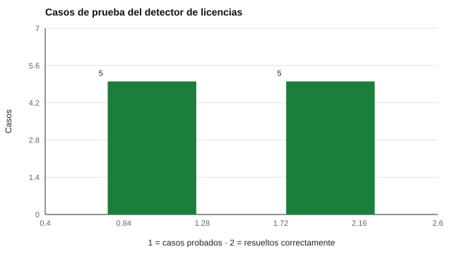

# 190 — Herramientas abiertas: jsPsych, PsychoPy, lab.js y PEBL


<!-- NAV -->
[← 189 — Interoperabilidad y exportación de resultados](../189-interoperabilidad-y-exportacion-de-resultados/README.md) · [📚 Parte 18](../README.md) · [🗺️ Índice 001–200](../../../PROGRAMA.md) · [191 — Proyecto: batería educativa de cribado con da… →](../../part-19-aplicaciones-avanzadas-y-proyectos-integradores/191-proyecto-bateria-educativa-de-cribado-con-datos/README.md)
<!-- /NAV -->

**Parte 18 — Ingeniería de sistemas de evaluación digital** · Nivel avanzado · 5 h · Estado `escrita`
**Pensada para:** quien incorpora librerías o bancos abiertos a un proyecto, y quien quiere saber bajo qué condiciones puede usarlos.
**Prerrequisitos:** clase 189.

> Material educativo, no asesoría jurídica. El detector reconoce familias de licencias, no la licencia exacta: las condiciones se leen en el archivo.

## ¿Para qué te sirve esto?

Existen herramientas abiertas para programar tareas experimentales y de evaluación: **jsPsych**, **PsychoPy**, **lab.js**, **PEBL**. Antes de incorporar cualquiera (o un banco de ítems «abierto») conviene hacer una pregunta incómoda: **¿su licencia es compatible con mi proyecto?** «Abierto» no significa «compatible»: una licencia GPL, por ejemplo, impone condiciones que una MIT no impone. Esta clase te enseña a **detectar la familia de una licencia** a partir de su texto, a usar una tabla de compatibilidad para un proyecto MIT y a registrar la revisión de cada recurso externo.

## Al terminar esta clase podrás

- Detectar la familia de una licencia a partir de su texto.
- Aplicar una tabla de compatibilidad para un proyecto MIT.
- Registrar la revisión de cada recurso externo.

## La idea en palabras simples

Antes de incorporar un recurso conviene leer su licencia (Open Source Initiative, *Open Source Definition*; Choose a License). El laboratorio detecta **MIT, Apache-2.0, GPL, LGPL, BSD y variantes Creative Commons** por frases características y aplica una guía de compatibilidad para un proyecto de código **MIT**. Una librería «abierta» puede tener licencia incompatible, y un banco de ítems puede tener condiciones propias (clase 102). Las herramientas del título se revisan una por una, con su propia ficha.

## Cómo funciona, paso a paso

**1. Leer** el archivo de licencia del recurso.

**2. Detectar** la familia y consultar la tabla de compatibilidad.

**3. Registrar** URL, versión, licencia leída, fecha de revisión y estado de mantenimiento.

**Ejemplo resuelto.** Antes de adoptar una librería: URL, versión, licencia leída, fecha de revisión y estado de mantenimiento quedan en su ficha.



*Figura 1.* El detector resolvió los cinco casos de prueba: MIT, GPL, Apache-2.0, CC BY-NC-SA y texto vacío.

## Si construyes el instrumento

- Lee la licencia exacta, no solo el nombre del repositorio.
- Registra cada recurso externo con su ficha de revisión.
- Respeta las condiciones propias de cada banco de ítems.
- Si dudas, consulta a un profesional del derecho.

## Si eres evaluado

- Los materiales de evaluación abiertos tienen condiciones: pregunta cuáles.
- Un instrumento «abierto» puede restringir usos comerciales.

## Qué muestra el laboratorio

| Archivo | Familia detectada | Compatibilidad con código MIT |
|---|---|---|
| LICENSE | MIT | sí (conservar el aviso de copyright) |

Casos de prueba del detector:

| Texto | Familia detectada |
|---|---|
| MIT | MIT |
| GPL | GPL |
| Apache | Apache-2.0 |
| CC BY-NC-SA | CC BY-NC-SA |
| Vacío | desconocida |

**Análisis.** (1) El detector solo reconoce familias por frases típicas; la licencia exacta y sus condiciones se leen en el archivo. (2) Una librería «abierta» puede tener licencia incompatible con tu proyecto. (3) Un banco de ítems puede tener condiciones propias. (4) Cada recurso adoptado queda registrado con su ficha.

## Errores frecuentes

- Asumir que «abierto» significa compatible.
- Detectar la licencia solo por el nombre del repositorio.
- Confiar en que el detector reconoce la licencia exacta.
- No registrar la revisión.

## Lo mínimo que debes llevarte

1. Abierto no es lo mismo que compatible.
2. La licencia se lee en el archivo.
3. El detector reconoce familias.
4. Cada recurso queda registrado con una ficha.

## Ejercicios

- **Inicial.** ¿Qué diferencia hay entre MIT y GPL para quien redistribuye? *Solución: MIT exige conservar el aviso; GPL exige además distribuir bajo la misma licencia (copyleft).*
- **Intermedio.** Añade la licencia MPL-2.0 al detector.
- **Avanzado.** Elabora la ficha de revisión de un recurso abierto de tu elección.
- **Aplicación.** Revisa la licencia de dos herramientas abiertas (por ejemplo, jsPsych y PsychoPy) y registra su ficha.

## Glosario

- **Licencia de código abierto:** permiso con condiciones para usar y redistribuir.
- **Copyleft:** condición que exige redistribuir bajo la misma licencia.
- **Compatibilidad:** posibilidad de combinar recursos de licencias distintas.
- **Ficha de revisión:** registro de lo verificado de un recurso.

## Laboratorio

```bash
python classes/part-18-ingenieria-de-sistemas-de-evaluacion-digital/190-herramientas-abiertas-jspsych-psychopy-lab-js-pebl/lab.py
python classes/part-18-ingenieria-de-sistemas-de-evaluacion-digital/figuras.py
```

## Autoevaluación y criterios

1. ¿Qué parte del diseño podría fallar sin que nadie lo note? 2. ¿Qué evidencia guardarías? 3. ¿Qué dato no deberías conservar?
Se logra la clase si implementas la idea, la pruebas con datos sintéticos y declaras sus límites.

## Bibliografía

- Open Source Initiative. *Open Source Definition*. opensource.org.
- Choose a License. choosealicense.com.

---

<!-- NAV -->
[← 189 — Interoperabilidad y exportación de resultados](../189-interoperabilidad-y-exportacion-de-resultados/README.md)  
[📚 Parte 18](../README.md) · [🗺️ Índice 001–200](../../../PROGRAMA.md)  
[191 — Proyecto: batería educativa de cribado con da… →](../../part-19-aplicaciones-avanzadas-y-proyectos-integradores/191-proyecto-bateria-educativa-de-cribado-con-datos/README.md)
<!-- /NAV -->
