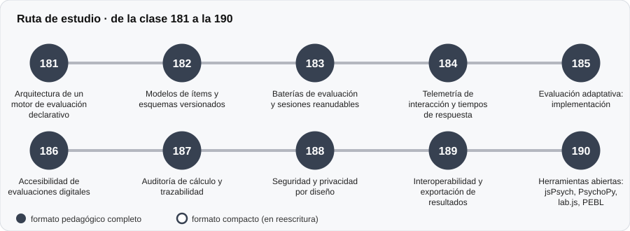

# ⚙️ Parte 18 — Ingeniería de sistemas de evaluación digital

**Nivel:** avanzado · **Duración estimada:** 4-5 semanas · **Clases:** 10

## De qué trata

Arquitectura, accesibilidad y seguridad de plataformas de evaluación digital.

## Por qué importa

Muchos errores de medición hoy son errores de software, accesibilidad o privacidad.

## Según tu papel

- **Si construyes o aplicas instrumentos:** Motor declarativo, esquemas versionados, baterías, auditoría de cálculo y exportación.
- **Si eres evaluado o recibes resultados:** Qué debe garantizar una plataforma sobre tus datos y tu acceso.

## Al terminar esta parte podrás

- Explicar cómo se agrega un instrumento solo con datos.
- Aplicar controles básicos de accesibilidad y privacidad.

## Cómo estudiarla

Se apoya en el código de `src/psychometrics`. Las clases 181 a 183 usan el motor real.

## Ruta de estudio

## Clases en orden de estudio

Las clases están numeradas de forma consecutiva (001 a 200) en el orden de estudio: sigue el número.

| Orden | ID | Clase | Qué aprenderás | Formato | Horas |
|---:|---|---|---|---|---:|
| 1 | 181 | [Arquitectura de un motor de evaluación declarativo](181-arquitectura-de-un-motor-de-evaluacion-declarativo/README.md) | Separar catálogo, administración, puntuación y datos normativos. | ✅ pedagógico | 4 |
| 2 | 182 | [Modelos de ítems y esquemas versionados](182-modelos-de-items-y-esquemas-versionados/README.md) | Validar estrictamente la definición de un instrumento. | ✅ pedagógico | 4 |
| 3 | 183 | [Baterías de evaluación y sesiones reanudables](183-baterias-de-evaluacion-y-sesiones-reanudables/README.md) | Agrupar instrumentos en una batería. | ✅ pedagógico | 4 |
| 4 | 184 | [Telemetría de interacción y tiempos de respuesta](184-telemetria-de-interaccion-y-tiempos-de-respuesta/README.md) | Calcular indicadores simples de respuesta descuidada. | ✅ pedagógico | 4 |
| 5 | 185 | [Evaluación adaptativa: implementación](185-evaluacion-adaptativa-implementacion/README.md) | Implementar un CAT con restricciones de contenido. | ✅ pedagógico | 4 |
| 6 | 186 | [Accesibilidad de evaluaciones digitales](186-accesibilidad-de-evaluaciones-digitales/README.md) | Calcular la relación de contraste WCAG. | ✅ pedagógico | 4 |
| 7 | 187 | [Auditoría de cálculo y trazabilidad](187-auditoria-de-calculo-y-trazabilidad/README.md) | Verificar el motor con una segunda implementación. | ✅ pedagógico | 4 |
| 8 | 188 | [Seguridad y privacidad por diseño](188-seguridad-y-privacidad-por-diseno/README.md) | Seudonimizar con HMAC en lugar de un hash simple. | ✅ pedagógico | 4 |
| 9 | 189 | [Interoperabilidad y exportación de resultados](189-interoperabilidad-y-exportacion-de-resultados/README.md) | Exportar en formato largo con metadatos. | ✅ pedagógico | 4 |
| 10 | 190 | [Herramientas abiertas: jsPsych, PsychoPy, lab.js, PEBL](190-herramientas-abiertas-jspsych-psychopy-lab-js-pebl/README.md) | Detectar la familia de una licencia a partir de su texto. | ✅ pedagógico | 4 |

[← Volver al índice del programa](../../README.md) · [Índice numérico de las 200 clases](../../PROGRAMA.md)
