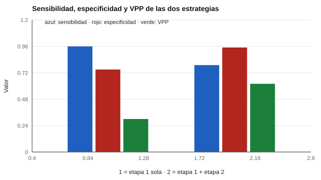

# 191 — Proyecto: batería educativa de cribado con datos


<!-- NAV -->
[← 190 — Herramientas abiertas: jsPsych, PsychoPy, lab…](../../part-18-ingenieria-de-sistemas-de-evaluacion-digital/190-herramientas-abiertas-jspsych-psychopy-lab-js-pebl/README.md) · [📚 Parte 19](../README.md) · [🗺️ Índice 001–200](../../../PROGRAMA.md) · [192 — Proyecto: batería laboral con ajuste justific… →](../192-proyecto-bateria-laboral-con-ajuste-justificado/README.md)
<!-- /NAV -->

**Parte 19 — Aplicaciones avanzadas y proyectos integradores** · Nivel avanzado · 5 h · Estado `escrita`
**Pensada para:** quien diseña un cribado escolar de principio a fin, y quien quiere ver cómo se integran las partes del programa.
**Prerrequisitos:** clase 145.

> Datos y condición sintéticos: en la vida real la condición verdadera no se observa. Un cribado orienta apoyo y seguimiento; no etiqueta.

## ¿Para qué te sirve esto?

Hasta aquí viste las piezas por separado: sensibilidad, especificidad, VPP, cribado escalonado, protocolos de derivación. Este proyecto las junta en un caso: **1 200 estudiantes** y una condición poco frecuente (el 10 % inferior de la habilidad). Diseñas un cribado en **dos etapas** y comparas dos estrategias: derivar a todos los que quedan bajo corte en la etapa 1, o derivar solo a quienes quedan bajo corte en **ambas** etapas. Verás que la elección no es técnica sino de valores: cuánto cuesta no apoyar a alguien y cuánto cuesta derivar de más.

## Al terminar esta clase podrás

- Diseñar un cribado en dos etapas.
- Evaluar sensibilidad, especificidad y VPP con una condición poco frecuente.
- Redactar los límites de un cribado.

## La idea en palabras simples

Un cribado en dos etapas aplica una prueba **breve** a todos y una prueba **más larga** solo a quienes quedan bajo el corte. Como la condición es poco frecuente, el VPP de la etapa 1 sola es bajo aunque su sensibilidad sea alta (clase 061; Jenkins, Hudson y Johnson, 2007, sobre cribado de lectores en riesgo). Exigir la segunda etapa **sube el VPP** a cambio de **perder sensibilidad**.

## Cómo funciona, paso a paso

**1. Simular** 1 200 estudiantes y definir la condición como el 10 % inferior de la habilidad.

**2. Aplicar** la etapa 1 (12 ítems) y derivar a quienes quedan bajo corte.

**3. Aplicar** la etapa 2 solo a esos derivados y comparar ambas estrategias.

**Ejemplo resuelto.** Derivar solo a quien queda bajo corte en ambas etapas reduce los derivados de 381 a 154 y duplica el VPP (0,30 → 0,62), a costa de perder 17 puntos de sensibilidad (0,96 → 0,79).



*Figura 1.* La segunda etapa sube el VPP y la especificidad, y baja la sensibilidad.

## Si construyes el instrumento

- Fija el corte con datos del contexto y revísalo (clase 145).
- Calcula el costo de cada estrategia con costos que tú defines y justificas.
- Prepara el protocolo de derivación y los apoyos (clase 168).
- Redacta los límites: orienta apoyo, no etiqueta.

## Si eres evaluado (o eres familia)

- Un resultado de cribado dice «conviene mirar con más detalle», no «tiene un problema».
- Pregunta qué sigue y qué apoyos hay mientras se espera.

## Qué muestra el laboratorio

| Estrategia | Derivados | Sensibilidad | Especificidad | VPP | Pruebas largas |
|---|---:|---:|---:|---:|---:|
| Etapa 1 sola (12 ítems) | 381 | 0,96 | 0,75 | 0,30 | 0 |
| Etapa 1 + etapa 2 (ambas bajo corte) | 154 | 0,79 | 0,95 | 0,62 | 381 |

**Análisis.** (1) La etapa 1 sola atrapa a casi todos pero deriva a muchos que no lo necesitan (VPP bajo, porque la condición es poco frecuente). (2) Exigir la segunda etapa sube el VPP a cambio de perder sensibilidad y de aplicar la prueba larga a los 381 derivados de la etapa 1. (3) El corte se fija con datos del contexto. (4) Datos sintéticos.

## Errores frecuentes

- Tratar el resultado del cribado como diagnóstico.
- Fijar el corte sin datos del contexto.
- Olvidar el costo de la segunda etapa.
- Creer que la condición verdadera se observa en la vida real.

## Lo mínimo que debes llevarte

1. El VPP es bajo cuando la condición es poco frecuente.
2. La segunda etapa lo sube, a costa de sensibilidad.
3. La elección depende de los costos de cada error.
4. Un cribado orienta; no etiqueta.

## Ejercicios

- **Inicial.** ¿Por qué el VPP es bajo con una condición poco frecuente? *Solución: porque entre los positivos hay muchos más no casos que casos.*
- **Intermedio.** Cambia el corte de la etapa 1 y observa el cambio de sensibilidad.
- **Avanzado.** Calcula el costo total de cada estrategia con costos que tú definas y justifiques.
- **Aplicación.** Redacta la sección «límites» del informe de este cribado.

## Glosario

- **Cribado en dos etapas:** prueba breve a todos y prueba larga a quienes quedan bajo corte.
- **VPP:** proporción de derivados que realmente tienen la condición.
- **Sensibilidad:** proporción de casos que el cribado detecta.
- **Especificidad:** proporción de no casos que el cribado deja pasar.

## Laboratorio

```bash
python classes/part-19-aplicaciones-avanzadas-y-proyectos-integradores/191-proyecto-bateria-educativa-de-cribado-con-datos/lab.py
python classes/part-19-aplicaciones-avanzadas-y-proyectos-integradores/figuras.py
```

## Autoevaluación y criterios

1. ¿Qué decisión de este proyecto es la más discutible? 2. ¿Qué evidencia falta? 3. ¿Qué dato no deberías conservar?
Se logra la clase si ejecutas el proyecto, interpretas sus cifras con cautela y declaras sus límites.

## Bibliografía

- AERA, APA, & NCME (2014). *Standards for Educational and Psychological Testing*. AERA.
- Jenkins, J. R., Hudson, R. F., & Johnson, E. S. (2007). Screening for at-risk readers in a response to intervention framework. *School Psychology Review*, 36(4), 582-600. [DOI](https://doi.org/10.1080/02796015.2007.12087919)

---

<!-- NAV -->
[← 190 — Herramientas abiertas: jsPsych, PsychoPy, lab…](../../part-18-ingenieria-de-sistemas-de-evaluacion-digital/190-herramientas-abiertas-jspsych-psychopy-lab-js-pebl/README.md)  
[📚 Parte 19](../README.md) · [🗺️ Índice 001–200](../../../PROGRAMA.md)  
[192 — Proyecto: batería laboral con ajuste justific… →](../192-proyecto-bateria-laboral-con-ajuste-justificado/README.md)
<!-- /NAV -->
