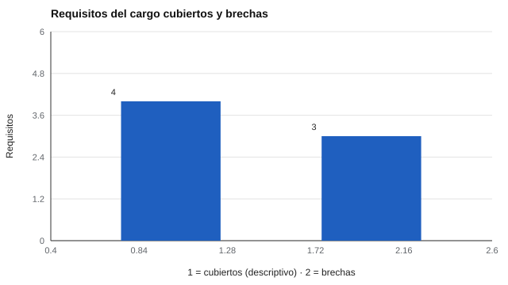

# 192 — Proyecto: batería laboral con ajuste justificado


<!-- NAV -->
[← 191 — Proyecto: batería educativa de cribado con da…](../191-proyecto-bateria-educativa-de-cribado-con-datos/README.md) · [📚 Parte 19](../README.md) · [🗺️ Índice 001–200](../../../PROGRAMA.md) · [193 — Proyecto: adaptación de un instrumento abierto →](../193-proyecto-adaptacion-de-un-instrumento-abierto/README.md)
<!-- /NAV -->

**Parte 19 — Aplicaciones avanzadas y proyectos integradores** · Nivel avanzado · 5 h · Estado `escrita`
**Pensada para:** quien arma una batería de evaluación para un cargo, y quien es evaluado con una.
**Prerrequisitos:** clase 119.

> Cargo ficticio. Las fichas de aptitud (CIE, AMP) están documentadas pero **no verificadas**: este repositorio no calcula un «porcentaje de ajuste» porque carece de normas y de evidencia de validez predictiva.

## ¿Para qué te sirve esto?

Armar una batería laboral suele hacerse al revés: se eligen tests conocidos y luego se les busca un uso. Aquí se hace al derecho. Se parte de un **análisis del puesto** (clase 111): cada instrumento se justifica por un **requisito** del cargo, y cada requisito sin instrumento se declara como **brecha** en vez de rellenarse. En el caso del proyecto, la batería con los instrumentos del repositorio cubre **4 de 7 requisitos** de forma descriptiva y deja **3 brechas** (comprensión de instrucciones, razonamiento numérico, dominio de herramientas de planificación).

## Al terminar esta clase podrás

- Traducir un perfil de cargo a requisitos evaluables.
- Justificar cada instrumento por un requisito.
- Declarar brechas en vez de rellenarlas.

## La idea en palabras simples

Una batería laboral se justifica desde un análisis del puesto: **cada instrumento responde a un requisito y cada requisito sin cobertura es una brecha** (AERA et al., 2014; SIOP, 2018, sobre validación y uso de procedimientos de selección). Un «porcentaje de ajuste» exigiría normas y evidencia de validez predictiva que este repositorio no tiene (clase 118), por lo que no se calcula. Los rasgos de personalidad describen **preferencias**, no desempeño futuro.

## Cómo funciona, paso a paso

**1. Listar** los 7 requisitos del cargo ficticio.

**2. Asignar** a cada requisito el instrumento y la escala que lo cubre, si existe.

**3. Declarar** las brechas y proponer cómo cubrirlas (pruebas de aptitud, muestras de trabajo con validez documentada).

**Ejemplo resuelto.** Para «estabilidad bajo presión» se usa la escala N del IPIP-NEO-120 como información descriptiva, no como predictor: la relación es un supuesto de diseño que debe respaldar el análisis de puesto.



*Figura 1.* Cuatro requisitos tienen cobertura descriptiva; tres son brechas.

## Si construyes el instrumento

- Parte del análisis del puesto, no del catálogo de tests.
- Justifica cada instrumento por un requisito.
- Declara las brechas en el informe.
- No uses personalidad como único criterio de selección.

## Si eres evaluado

- Pregunta qué requisito del cargo justifica cada prueba que te piden.
- Un informe honesto declara qué no se evaluó.
- Un perfil de personalidad no predice por sí solo tu desempeño.

## Qué muestra el laboratorio

| Requisito del cargo | Cobertura | Estado |
|---|---|---|
| Organización y cumplimiento de plazos | ipip-neo-120 / C | cubierto (descriptivo) |
| Orientación a personas y colaboración | ipip-neo-120 / A | cubierto (descriptivo) |
| Estabilidad bajo presión | ipip-neo-120 / N | cubierto (descriptivo) |
| Intereses vocacionales hacia la gestión | onet-riasec-sf / E | cubierto (descriptivo) |
| Comprensión de instrucciones escritas | — | BRECHA |
| Razonamiento numérico | — | BRECHA |
| Dominio de herramientas de planificación | — | BRECHA |

**Análisis.** (1) La batería no cubre habilidades cognitivas ni conocimientos técnicos. (2) Esos requisitos se evalúan con pruebas de aptitud y muestras de trabajo cuya validez se documente. (3) Los rasgos describen preferencias, no desempeño futuro. (4) El informe entrega evidencia descriptiva y brechas, no un puntaje de ajuste.

## Errores frecuentes

- Usar personalidad como único criterio de selección.
- Inventar porcentajes de ajuste.
- Rellenar las brechas con instrumentos que no corresponden.
- Usar fichas no verificadas como si lo estuvieran.

## Lo mínimo que debes llevarte

1. Cada instrumento se justifica por un requisito.
2. Cada requisito sin instrumento es una brecha.
3. No se calcula un porcentaje de ajuste sin evidencia.
4. La personalidad es evidencia descriptiva.

## Ejercicios

- **Inicial.** ¿Qué es una brecha en una batería? *Solución: un requisito del cargo que ningún instrumento cubre.*
- **Intermedio.** Añade un requisito y decide si se cubre o es brecha.
- **Avanzado.** Escribe el procedimiento de análisis de puesto que respaldaría una relación requisito–escala.
- **Aplicación.** Arma una tabla requisito–instrumento–estado para un cargo que conozcas.

## Glosario

- **Batería laboral:** conjunto de instrumentos para evaluar a una persona frente a un cargo.
- **Requisito:** conocimiento, habilidad o característica que exige el cargo.
- **Brecha:** requisito sin cobertura.
- **Evidencia descriptiva:** información que describe sin predecir.

## Laboratorio

```bash
python classes/part-19-aplicaciones-avanzadas-y-proyectos-integradores/192-proyecto-bateria-laboral-con-ajuste-justificado/lab.py
python classes/part-19-aplicaciones-avanzadas-y-proyectos-integradores/figuras.py
```

## Autoevaluación y criterios

1. ¿Qué decisión de este proyecto es la más discutible? 2. ¿Qué evidencia falta? 3. ¿Qué dato no deberías conservar?
Se logra la clase si ejecutas el proyecto, interpretas sus cifras con cautela y declaras sus límites.

## Bibliografía

- AERA, APA, & NCME (2014). *Standards for Educational and Psychological Testing*. AERA. 🔎 sin verificar (libro, norma o sitio no hallado en Crossref: comprobar a mano)
- Society for Industrial and Organizational Psychology (2018). *Principles for the Validation and Use of Personnel Selection Procedures* (5.ª ed.). ✅ [DOI](https://doi.org/10.1017/iop.2018.195)

Leyenda: ✅ existe en Crossref con título y año coincidentes (enlace al DOI); ⚠️ hay una obra de título parecido con otro año (no se enlaza: comprobar la edición); 🔎 no verificada automáticamente (libros sin DOI, normas y sitios web). Crossref confirma la existencia de la fuente, no que respalde cada afirmación de la clase. Ver [`docs/VERIFICACION_BIBLIOGRAFIA.md`](../../../docs/VERIFICACION_BIBLIOGRAFIA.md).

---

<!-- NAV -->
[← 191 — Proyecto: batería educativa de cribado con da…](../191-proyecto-bateria-educativa-de-cribado-con-datos/README.md)  
[📚 Parte 19](../README.md) · [🗺️ Índice 001–200](../../../PROGRAMA.md)  
[193 — Proyecto: adaptación de un instrumento abierto →](../193-proyecto-adaptacion-de-un-instrumento-abierto/README.md)
<!-- /NAV -->
