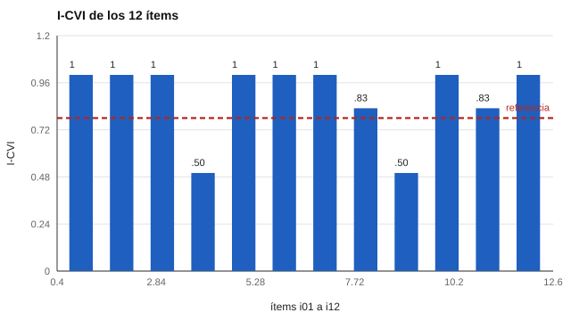

# 193 — Proyecto: adaptación de un instrumento abierto


<!-- NAV -->
[← 192 — Proyecto: batería laboral con ajuste justific…](../192-proyecto-bateria-laboral-con-ajuste-justificado/README.md) · [📚 Parte 19](../README.md) · [🗺️ Índice 001–200](../../../PROGRAMA.md) · [194 — Proyecto: informe para familias y docentes →](../194-proyecto-informe-para-familias-y-docentes/README.md)
<!-- /NAV -->

**Parte 19 — Aplicaciones avanzadas y proyectos integradores** · Nivel avanzado · 5 h · Estado `escrita`
**Pensada para:** quien adapta un instrumento a otro idioma o cultura, y quien responde instrumentos adaptados.
**Prerrequisitos:** clase 180.

> Las etapas con personas reales (1, 2, 4 y 6) se marcan superadas **solo para ilustrar el flujo**. Datos sintéticos.

## ¿Para qué te sirve esto?

«Traducimos el cuestionario y lo aplicamos.» Eso no es una adaptación. Si los ítems pierden su significado al cambiar de idioma o de cultura, los puntajes de dos grupos **no se pueden comparar**. Una adaptación seria avanza por **etapas con compuertas**: permiso y licencia, traducción y retrotraducción, validez de contenido, entrevistas cognitivas, piloto y equivalencia. Y lo importante: **si una compuerta no se cumple, el proceso se detiene**. En el proyecto, dos ítems con acuerdo bajo entre jueces detienen todo en la etapa 3.

## Al terminar esta clase podrás

- Ordenar la adaptación en etapas con compuertas.
- Calcular el I-CVI y el S-CVI/Ave.
- Detener el proceso cuando una compuerta no se cumple.

## La idea en palabras simples

Una adaptación no es una traducción: avanza por **permiso, traducción y retrotraducción, validez de contenido, entrevistas cognitivas, piloto y equivalencia** (Beaton et al., 2000; International Test Commission, 2017). El **I-CVI** de un ítem es la proporción de jueces que lo califican como relevante (3 o 4 en una escala de 4; Lynn, 1986). El **S-CVI/Ave** es el promedio de los I-CVI. Con 6 jueces, un ítem exige I-CVI ≥ 0,78 (5 de 6 acuerdos o más; con más jueces el umbral cambia).

## Cómo funciona, paso a paso

**1. Verificar** permiso y licencia, y traducir/retrotraducir.

**2. Calcular** el I-CVI de cada ítem con 6 jueces y el S-CVI/Ave.

**3. Detener** el proceso si algún ítem queda bajo 0,78; reescribir y repetir la etapa.

**Ejemplo resuelto.** Los dos ítems con I-CVI 0,50 se reescriben y se repite la etapa 3; el piloto no se inicia hasta superarla.



*Figura 1.* Dos ítems quedan bajo el umbral y detienen el protocolo.

## Si construyes el instrumento

- Obtén el permiso y respeta la licencia.
- No avances al piloto con ítems cuestionados por expertos.
- Haz entrevistas cognitivas con personas reales.
- Demuestra invarianza o DIF antes de comparar grupos.

## Si eres evaluado

- Un instrumento adaptado debería haber pasado estas etapas.
- Pregunta si hay evidencia de equivalencia para tu grupo.
- Sin equivalencia, tu puntaje no es comparable con el de otras culturas.

## Qué muestra el laboratorio

I-CVI por ítem: i01 1,00; i02 1,00; i03 1,00; **i04 0,50**; i05 1,00; i06 1,00; i07 1,00; i08 0,83; **i09 0,50**; i10 1,00; i11 0,83; i12 1,00. S-CVI/Ave = 0,89. Alfa del piloto (sintético, n = 250): 0,92.

| Etapa | Estado |
|---|---|
| 1 Permiso y licencia verificados | superada |
| 2 Traducción y retrotraducción | superada |
| 3 Validez de contenido (todos los ítems ≥ 0,78) | **DETENIDO** → reescribir i04 e i09 y repetir |
| 4 Entrevistas cognitivas | pendiente |
| 5 Piloto con alfa ≥ 0,70 | pendiente |
| 6 Invarianza/DIF antes de comparar grupos | pendiente |

**Análisis.** (1) Las compuertas impiden construir un estudio piloto sobre ítems que los expertos ya cuestionan. (2) Un S-CVI/Ave de 0,89 no compensa dos ítems en 0,50. (3) Las etapas 1, 2, 4 y 6 requieren personas reales. (4) Sin equivalencia demostrada no se comparan puntajes entre culturas.

## Errores frecuentes

- Avanzar al piloto con ítems cuestionados.
- Comparar puntajes entre culturas sin equivalencia.
- Confundir adaptación con traducción.
- Promediar para esconder ítems malos.

## Lo mínimo que debes llevarte

1. Adaptar es más que traducir.
2. Las etapas tienen compuertas.
3. I-CVI mide el acuerdo de los jueces por ítem.
4. Sin equivalencia no se comparan puntajes.

## Ejercicios

- **Inicial.** ¿Qué mide el I-CVI? *Solución: la proporción de jueces que consideran relevante un ítem.*
- **Intermedio.** Cambia el número de jueces a 10 y revisa el umbral aplicable.
- **Avanzado.** Diseña el protocolo de entrevistas cognitivas para los ítems reescritos.
- **Aplicación.** Prepara la lista de verificación de las seis etapas para un instrumento que quieras adaptar.

## Glosario

- **Adaptación transcultural:** proceso de ajustar un instrumento a otra cultura o idioma.
- **Retrotraducción:** traducir de vuelta al idioma original para comparar.
- **I-CVI / S-CVI/Ave:** índices de validez de contenido por ítem / promedio.
- **Compuerta:** condición que debe cumplirse para pasar a la siguiente etapa.

## Laboratorio

```bash
python classes/part-19-aplicaciones-avanzadas-y-proyectos-integradores/193-proyecto-adaptacion-de-un-instrumento-abierto/lab.py
python classes/part-19-aplicaciones-avanzadas-y-proyectos-integradores/figuras.py
```

## Autoevaluación y criterios

1. ¿Qué decisión de este proyecto es la más discutible? 2. ¿Qué evidencia falta? 3. ¿Qué dato no deberías conservar?
Se logra la clase si ejecutas el proyecto, interpretas sus cifras con cautela y declaras sus límites.

## Bibliografía

- Beaton, D. E., Bombardier, C., Guillemin, F., & Ferraz, M. B. (2000). Guidelines for the process of cross-cultural adaptation of self-report measures. *Spine*, 25(24), 3186-3191. [DOI](https://doi.org/10.1097/00007632-200012150-00014)
- Lynn, M. R. (1986). Determination and quantification of content validity. *Nursing Research*, 35(6), 382-385. [DOI](https://doi.org/10.1097/00006199-198611000-00017)
- International Test Commission (2017). *ITC Guidelines for Translating and Adapting Tests* (2.ª ed.). *International Journal of Testing*, 18(2), 101-134. [DOI](https://doi.org/10.1080/15305058.2017.1398166)

---

<!-- NAV -->
[← 192 — Proyecto: batería laboral con ajuste justific…](../192-proyecto-bateria-laboral-con-ajuste-justificado/README.md)  
[📚 Parte 19](../README.md) · [🗺️ Índice 001–200](../../../PROGRAMA.md)  
[194 — Proyecto: informe para familias y docentes →](../194-proyecto-informe-para-familias-y-docentes/README.md)
<!-- /NAV -->
