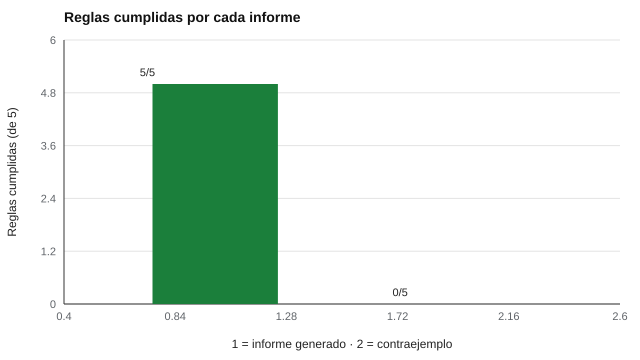

# 194 — Proyecto: informe para familias y docentes


<!-- NAV -->
[← 193 — Proyecto: adaptación de un instrumento abierto](../193-proyecto-adaptacion-de-un-instrumento-abierto/README.md) · [📚 Parte 19](../README.md) · [🗺️ Índice 001–200](../../../PROGRAMA.md) · [195 — Proyecto: informe para una organización →](../195-proyecto-informe-para-una-organizacion/README.md)
<!-- /NAV -->

**Parte 19 — Aplicaciones avanzadas y proyectos integradores** · Nivel avanzado · 5 h · Estado `escrita`
**Pensada para:** quien redacta informes de resultados, y familias y docentes que los leen.
**Prerrequisitos:** clase 073.

> El revisor automático detecta la forma, no el fondo: la revisión de un profesional evalúa el contenido.

## ¿Para qué te sirve esto?

Un informe a una familia es una **intervención**: puede tranquilizar, asustar o fijar una expectativa que dure años. «Pedro padece dislexia» y «el rendimiento de Pedro estuvo cerca de 52 puntos, con un intervalo razonable entre 44 y 60; sugerimos leer 10 minutos al día y revisar en cuatro semanas» comunican cosas muy distintas. Esta clase te da cinco reglas para redactar y un **revisor automático** que las comprueba, y te muestra un informe que cumple las cinco y un contraejemplo que no cumple ninguna.

## Al terminar esta clase podrás

- Comunicar resultados con incertidumbre.
- Evitar etiquetas diagnósticas y lenguaje determinista.
- Verificar un informe con reglas explícitas.

## La idea en palabras simples

El informe a familias **describe lo observado**, **incluye la incertidumbre**, **propone pasos concretos** y **declara su alcance** (AERA et al., 2014; ITC, 2013, sobre uso de pruebas). Las cinco reglas del revisor:

1. Sin etiquetas diagnósticas.
2. Sin lenguaje determinista.
3. Con intervalo (incertidumbre).
4. Con recomendaciones.
5. Con aclaración de que no es un diagnóstico.

## Cómo funciona, paso a paso

**1. Redactar** el informe describiendo lo observado en esta aplicación.

**2. Pasar** el revisor automático de cinco reglas.

**3. Someter** el informe a la lectura de un profesional y, si es posible, de una familia.

**Ejemplo resuelto.** En vez de «Pedro padece dislexia», se escribe «el rendimiento estuvo cerca de 52 puntos, con un intervalo razonable entre 44 y 60; sugerimos leer 10 minutos al día y revisar en cuatro semanas».



*Figura 1.* El contraejemplo falla las cinco reglas.

## Si construyes el instrumento

- Describe lo observado; no etiquetes.
- Entrega el número con su intervalo.
- Propón pasos concretos y fecha de revisión.
- Aclara que no es un diagnóstico.

## Si eres evaluado (o eres familia)

- Pide que el informe incluya el intervalo y qué hacer ahora.
- Un número sin contexto no debería usarse para decidir sobre tu hijo o hija.
- Tienes derecho a preguntar y a una segunda opinión.

## Qué muestra el laboratorio

| Regla | Informe generado | Contraejemplo |
|---|---|---|
| Sin etiquetas diagnósticas | ok | FALLA |
| Sin lenguaje determinista | ok | FALLA |
| Incluye incertidumbre | ok | FALLA |
| Incluye recomendaciones | ok | FALLA |
| Declara que no es diagnóstico | ok | FALLA |
| Total | 5/5 | 0/5 |

**Análisis.** (1) La comunicación a familias es una intervención: una etiqueta o un número sin contexto puede fijar expectativas y dañar. (2) El informe describe lo observado, incluye la incertidumbre, propone pasos y aclara su alcance. (3) El revisor automático detecta forma; el fondo lo evalúa un profesional. (4) El ejemplo es ficticio.

## Errores frecuentes

- Creer que pasar la lista asegura un buen informe.
- Entregar un número sin su intervalo.
- Usar etiquetas diagnósticas.
- Omitir recomendaciones concretas.

## Lo mínimo que debes llevarte

1. El informe es una intervención.
2. Se describe, no se etiqueta.
3. Se entrega el intervalo y los pasos siguientes.
4. La lista detecta forma, no fondo.

## Ejercicios

- **Inicial.** ¿Por qué se incluye el intervalo? *Solución: porque todo puntaje tiene error de medida y el intervalo evita una falsa precisión.*
- **Intermedio.** Añade una regla sobre comparar con otros estudiantes.
- **Avanzado.** Reescribe un informe real (anonimizado) con las cinco reglas.
- **Aplicación.** Redacta un informe de dos párrafos para una familia a partir de un resultado ficticio.

## Glosario

- **Etiqueta diagnóstica:** nombre de un trastorno aplicado a una persona.
- **Lenguaje determinista:** formulaciones que dan algo por seguro («es», «siempre»).
- **Intervalo razonable:** rango de valores compatibles con el puntaje.
- **Alcance del informe:** qué puede y qué no puede concluirse de él.

## Laboratorio

```bash
python classes/part-19-aplicaciones-avanzadas-y-proyectos-integradores/194-proyecto-informe-para-familias-y-docentes/lab.py
python classes/part-19-aplicaciones-avanzadas-y-proyectos-integradores/figuras.py
```

## Autoevaluación y criterios

1. ¿Qué decisión de este proyecto es la más discutible? 2. ¿Qué evidencia falta? 3. ¿Qué dato no deberías conservar?
Se logra la clase si ejecutas el proyecto, interpretas sus cifras con cautela y declaras sus límites.

## Bibliografía

- AERA, APA, & NCME (2014). *Standards for Educational and Psychological Testing*. AERA. 🔎 sin verificar (libro, norma o sitio no hallado en Crossref: comprobar a mano)
- International Test Commission (2013). *ITC Guidelines on Test Use*. ITC. 🔎 sin verificar (libro, norma o sitio no hallado en Crossref: comprobar a mano)

Leyenda: ✅ existe en Crossref con título y año coincidentes (enlace al DOI); ⚠️ hay una obra de título parecido con otro año (no se enlaza: comprobar la edición); 🔎 no verificada automáticamente (libros sin DOI, normas y sitios web). Crossref confirma la existencia de la fuente, no que respalde cada afirmación de la clase. Ver [`docs/VERIFICACION_BIBLIOGRAFIA.md`](../../../docs/VERIFICACION_BIBLIOGRAFIA.md).

---

<!-- NAV -->
[← 193 — Proyecto: adaptación de un instrumento abierto](../193-proyecto-adaptacion-de-un-instrumento-abierto/README.md)  
[📚 Parte 19](../README.md) · [🗺️ Índice 001–200](../../../PROGRAMA.md)  
[195 — Proyecto: informe para una organización →](../195-proyecto-informe-para-una-organizacion/README.md)
<!-- /NAV -->
