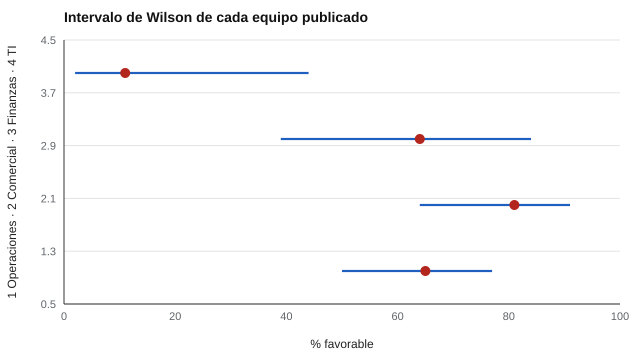

# 195 — Proyecto: informe para una organización


<!-- NAV -->
[← 194 — Proyecto: informe para familias y docentes](../194-proyecto-informe-para-familias-y-docentes/README.md) · [📚 Parte 19](../README.md) · [🗺️ Índice 001–200](../../../PROGRAMA.md) · [196 — Proyecto: estudio de validación simulado de e… →](../196-proyecto-estudio-de-validacion-simulado-de-extremo/README.md)
<!-- /NAV -->

**Parte 19 — Aplicaciones avanzadas y proyectos integradores** · Nivel avanzado · 5 h · Estado `escrita`
**Pensada para:** quien informa una encuesta por equipo, y quien trabaja en un equipo pequeño que será medido.
**Prerrequisitos:** clase 112.

> Datos sintéticos. El clima es una percepción colectiva: no es un diagnóstico de las personas ni una evaluación de quien lidera. Las normas de datos personales (Ley 19.628 y Ley 21.719) se verifican en bcn.cl.

## ¿Para qué te sirve esto?

Una encuesta de clima arroja «Operaciones 65 %, Comercial 81 %, TI 11 %». ¿Hay que intervenir en TI? Depende: TI respondió con **9 personas**, y un porcentaje basado en 9 personas es muy impreciso. Además, el equipo de Legal tiene **3 personas**: informar su resultado casi identifica lo que respondió cada una. Este proyecto integra tres ideas de clases anteriores: **intervalos de Wilson** (clase 166), **supresión por n mínimo** (clase 128) y **comparar solo cuando los intervalos no se solapan**.

## Al terminar esta clase podrás

- Resumir una encuesta por equipo con intervalos de Wilson.
- Aplicar supresión por n mínimo.
- Evitar afirmar diferencias que los intervalos no sostienen.

## La idea en palabras simples

El porcentaje favorable de un equipo pequeño es una estimación muy imprecisa; el **intervalo de Wilson al 95 %** es mejor que el de Wald con pocos casos (Brown et al., 2001). Para proteger la identidad se **suprime todo grupo con menos de cinco respuestas**. Solo se mencionan diferencias entre equipos cuando **sus intervalos no se solapan**, y aun así son descriptivas: no prueban causas.

## Cómo funciona, paso a paso

**1. Calcular** el porcentaje favorable y el intervalo de Wilson de cada equipo.

**2. Suprimir** los equipos con n < 5.

**3. Comparar** pares de equipos solo si sus intervalos están separados.

**Ejemplo resuelto.** El equipo de 3 personas no se informa ni se calcula por resta: un informe agregado no debe permitir deducir lo que respondió una persona.



*Figura 1.* Los intervalos de equipos pequeños son anchos.

## Si construyes el instrumento

- Informa el intervalo, no solo el porcentaje.
- Suprime grupos pequeños y explica el criterio en el informe.
- Evita deducciones por resta entre niveles agregados.
- No presentes el clima como evaluación de quien lidera.

## Si eres evaluado

- Si tu equipo es pequeño, tu respuesta puede quedar expuesta: pregunta cómo se protege.
- Un porcentaje bajo en un equipo de 9 personas puede ser muy impreciso.

## Qué muestra el laboratorio

| Equipo | n | Favorables | IC 95 % (Wilson) | Publicación |
|---|---:|---:|---|---|
| Operaciones | 48 | 65 % | [50 %; 77 %] | publicado |
| Comercial | 31 | 81 % | [64 %; 91 %] | publicado |
| Finanzas | 14 | 64 % | [39 %; 84 %] | publicado |
| TI | 9 | 11 % | [2 %; 44 %] | publicado |
| Legal | 3 | — | — | SUPRIMIDO (n < 5) |

Comparaciones sustentadas por los intervalos: Operaciones y TI; Comercial y TI.

**Análisis.** (1) Con pocas personas los intervalos son amplios: un porcentaje puntual no autoriza a decir que un equipo «está peor». (2) Solo cuentan las diferencias con intervalos separados, y aun así son descriptivas. (3) La supresión con n mínimo protege la identidad; el informe explica el criterio. (4) El clima es una percepción colectiva.

## Errores frecuentes

- Publicar equipos de 2 o 3 personas.
- Interpretar el clima como evaluación de quien lidera.
- Comparar porcentajes sin mirar los intervalos.
- Permitir deducir respuestas individuales por resta.

## Lo mínimo que debes llevarte

1. Wilson es mejor que Wald con n pequeño.
2. Se suprimen grupos con menos de 5 respuestas.
3. Solo se comparan intervalos separados.
4. El clima no es una evaluación de personas.

## Ejercicios

- **Inicial.** ¿Por qué Wilson y no Wald con n pequeño? *Solución: porque Wald puede dar intervalos fuera de [0, 1] o muy estrechos y cubre peor con pocos casos.*
- **Intermedio.** Cambia el n mínimo a 8 y observa qué se suprime.
- **Avanzado.** Diseña una regla de supresión complementaria.
- **Aplicación.** Redacta la nota metodológica del informe: criterio de supresión, intervalos y alcance.

## Glosario

- **Intervalo de Wilson:** intervalo de confianza para una proporción.
- **Supresión por n mínimo:** no publicar grupos bajo un tamaño.
- **Deducción por resta:** obtener un dato oculto restando totales publicados.
- **Percepción colectiva:** clima visto desde el conjunto de respuestas.

## Laboratorio

```bash
python classes/part-19-aplicaciones-avanzadas-y-proyectos-integradores/195-proyecto-informe-para-una-organizacion/lab.py
python classes/part-19-aplicaciones-avanzadas-y-proyectos-integradores/figuras.py
```

## Autoevaluación y criterios

1. ¿Qué decisión de este proyecto es la más discutible? 2. ¿Qué evidencia falta? 3. ¿Qué dato no deberías conservar?
Se logra la clase si ejecutas el proyecto, interpretas sus cifras con cautela y declaras sus límites.

## Bibliografía

- Brown, L. D., Cai, T. T., & DasGupta, A. (2001). Interval estimation for a binomial proportion. *Statistical Science*, 16(2), 101-133. ✅ [DOI](https://doi.org/10.1214/ss/1009213286)
- Ley 19.628 y Ley 21.719 (Chile): verificar el texto vigente en bcn.cl. 🔎 sin verificar (libro, norma o sitio no hallado en Crossref: comprobar a mano)

Leyenda: ✅ existe en Crossref con título y año coincidentes (enlace al DOI); ⚠️ hay una obra de título parecido con otro año (no se enlaza: comprobar la edición); 🔎 no verificada automáticamente (libros sin DOI, normas y sitios web). Crossref confirma la existencia de la fuente, no que respalde cada afirmación de la clase. Ver [`docs/VERIFICACION_BIBLIOGRAFIA.md`](../../../docs/VERIFICACION_BIBLIOGRAFIA.md).

---

<!-- NAV -->
[← 194 — Proyecto: informe para familias y docentes](../194-proyecto-informe-para-familias-y-docentes/README.md)  
[📚 Parte 19](../README.md) · [🗺️ Índice 001–200](../../../PROGRAMA.md)  
[196 — Proyecto: estudio de validación simulado de e… →](../196-proyecto-estudio-de-validacion-simulado-de-extremo/README.md)
<!-- /NAV -->
