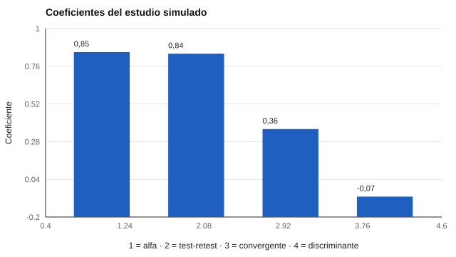

# 196 — Proyecto: estudio de validación simulado de extremo a extremo


<!-- NAV -->
[← 195 — Proyecto: informe para una organización](../195-proyecto-informe-para-una-organizacion/README.md) · [📚 Parte 19](../README.md) · [🗺️ Índice 001–200](../../../PROGRAMA.md) · [197 — Proyecto: auditoría ética de un instrumento →](../197-proyecto-auditoria-etica-de-un-instrumento/README.md)
<!-- /NAV -->

**Parte 19 — Aplicaciones avanzadas y proyectos integradores** · Nivel avanzado · 5 h · Estado `escrita`
**Pensada para:** quien quiere ver un estudio de validación completo en miniatura, y quien debe leer uno con ojo crítico.
**Prerrequisitos:** clase 180.

> Datos sintéticos: que el estudio recupere la verdad simulada no prueba validez en personas reales.

## ¿Para qué te sirve esto?

Este proyecto junta las clases 171 a 180 en un solo recorrido: diseño, datos, fiabilidad, validez, informe y revisión. Como los datos son simulados, **se conoce la verdad** (cuánta fiabilidad real tiene el instrumento, qué criterio está relacionado y cuál no), y así puedes comprobar si el análisis la **recupera**. Es un ensayo general: te muestra qué debería aparecer en un estudio bien hecho y te recuerda por qué el éxito en datos simulados no basta cuando se trata de personas.

## Al terminar esta clase podrás

- Integrar diseño, datos, fiabilidad, validez e informe.
- Comprobar que el estudio recupera la verdad simulada.
- Revisar el informe con la lista de la clase 180.

## La idea en palabras simples

Con datos sintéticos se conoce la verdad del modelo, así que se puede comprobar si el análisis la recupera. Se simula un **factor de 10 ítems**, **dos aplicaciones** (para test–retest) y **dos criterios**: uno relacionado (validez **convergente**) y uno ajeno (validez **discriminante**). El informe se redacta cualificando cada afirmación (Appelbaum et al., 2018; AERA et al., 2014) y se pasa por la lista de la clase 180.

## Cómo funciona, paso a paso

**1. Simular** 300 personas con un factor de 10 ítems y dos criterios.

**2. Estimar** alfa con su intervalo bootstrap, el test–retest y las correlaciones convergente y discriminante.

**3. Redactar** el informe y pasarlo por la lista de 4 reglas.

**Ejemplo resuelto.** El informe califica el «válido» como válido para describir el constructo en datos simulados, no para decisiones sobre personas reales, y declara sus limitaciones.



*Figura 1.* El estudio recupera la fiabilidad y distingue convergente de discriminante.

## Si construyes el instrumento

- Declara el plan antes del análisis (preinscripción).
- Informa cada coeficiente con n e intervalo.
- Cualifica la validez: para quién y para qué.
- Añade equidad (DIF, invarianza) y replicación antes de usar con personas.

## Si eres evaluado

- Un estudio simulado no te dice cómo funcionará un instrumento contigo.
- Pregunta si hubo estudios con personas como tú y si se revisó la equidad.

## Qué muestra el laboratorio

| Medida | Valor |
|---|---:|
| Alfa (n = 300) | 0,85, IC 95 % bootstrap [0,83; 0,87] |
| Test–retest | 0,84 |
| Validez convergente (criterio relacionado) | 0,36 |
| Validez discriminante (variable ajena) | −0,07 |
| Fiabilidad verdadera de la suma (omega teórico) | 0,88 |
| Revisión automática (lista de la clase 180) | 4/4 criterios |

**Análisis.** (1) El estudio recupera la fiabilidad que se simuló y distingue validez convergente de discriminante. (2) Que el informe pase la lista solo prueba su forma. (3) La validez en personas reales exige muestras reales, equidad entre grupos y replicación. (4) Este proyecto integra las clases 171–180.

## Errores frecuentes

- Creer que el éxito en datos simulados prueba validez en personas.
- Omitir equidad e invarianza.
- Usar la lista automática como prueba de calidad.
- Olvidar cualificar la validez.

## Lo mínimo que debes llevarte

1. Con datos simulados se conoce la verdad.
2. Se informan fiabilidad, validez convergente y discriminante.
3. El informe cualifica y declara limitaciones.
4. Falta equidad y replicación con personas reales.

## Ejercicios

- **Inicial.** ¿Qué ventaja tiene conocer la verdad simulada? *Solución: permite comprobar si el análisis recupera lo que debería.*
- **Intermedio.** Reduce a 5 ítems y observa alfa y su intervalo.
- **Avanzado.** Añade DIF por grupo simulado al estudio.
- **Aplicación.** Redacta el resumen de dos párrafos del informe de este estudio con sus limitaciones.

## Glosario

- **Validez convergente / discriminante:** relación con lo relacionado / con lo ajeno.
- **Test–retest:** correlación entre dos aplicaciones.
- **Omega:** coeficiente de fiabilidad basado en cargas factoriales.
- **Recuperar la verdad:** que el análisis estime lo que se simuló.

## Laboratorio

```bash
python classes/part-19-aplicaciones-avanzadas-y-proyectos-integradores/196-proyecto-estudio-de-validacion-simulado-de-extremo/lab.py
python classes/part-19-aplicaciones-avanzadas-y-proyectos-integradores/figuras.py
```

## Autoevaluación y criterios

1. ¿Qué decisión de este proyecto es la más discutible? 2. ¿Qué evidencia falta? 3. ¿Qué dato no deberías conservar?
Se logra la clase si ejecutas el proyecto, interpretas sus cifras con cautela y declaras sus límites.

## Bibliografía

- AERA, APA, & NCME (2014). *Standards for Educational and Psychological Testing*. AERA.
- Appelbaum, M., et al. (2018). Journal article reporting standards for quantitative research in psychology. *American Psychologist*, 73(1), 3-25. [DOI](https://doi.org/10.1037/amp0000191)

---

<!-- NAV -->
[← 195 — Proyecto: informe para una organización](../195-proyecto-informe-para-una-organizacion/README.md)  
[📚 Parte 19](../README.md) · [🗺️ Índice 001–200](../../../PROGRAMA.md)  
[197 — Proyecto: auditoría ética de un instrumento →](../197-proyecto-auditoria-etica-de-un-instrumento/README.md)
<!-- /NAV -->
