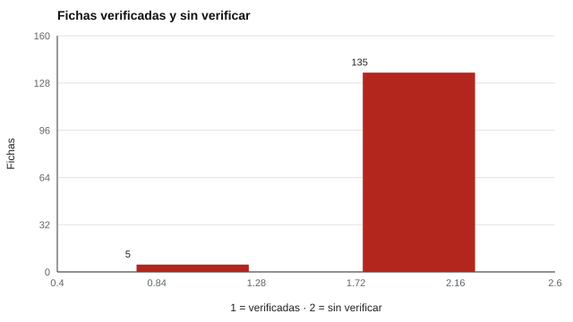

# 197 — Proyecto: auditoría ética de un instrumento


<!-- NAV -->
[← 196 — Proyecto: estudio de validación simulado de e…](../196-proyecto-estudio-de-validacion-simulado-de-extremo/README.md) · [📚 Parte 19](../README.md) · [🗺️ Índice 001–200](../../../PROGRAMA.md) · [198 — Proyecto: tablero de seguimiento longitudinal →](../198-proyecto-tablero-de-seguimiento-longitudinal/README.md)
<!-- /NAV -->

**Parte 19 — Aplicaciones avanzadas y proyectos integradores** · Nivel avanzado · 5 h · Estado `escrita`
**Pensada para:** quien revisa catálogos o instrumentos antes de usarlos, y quien debe confiar en su descripción.
**Prerrequisitos:** clase 078.

> La lista de control es parcial. Un script no contrasta una ficha con su fuente primaria: eso lo hace una persona.

## ¿Para qué te sirve esto?

Una auditoría solo sirve si **puede fallar** y si **muestra** lo que encuentra. En este proyecto se audita el catálogo real del repositorio con cinco controles: consistencia de las fichas, estados sin evidencia, propiedad intelectual y marca de «sin validar» en los instrumentos propios. Cuatro controles cumplen. El quinto (D) revela el **hallazgo principal**: de 140 fichas, **solo 5 están verificadas** y 135 siguen sin verificar contra su fuente primaria. Es un hallazgo honesto, y la clase te enseña a informarlo en vez de esconderlo.

## Al terminar esta clase podrás

- Auditar fichas e instrumentos con una lista de control.
- Distinguir lo que el script verifica de lo que exige un humano.
- Informar los hallazgos sin ocultarlos.

## La idea en palabras simples

Una buena auditoría separa dos tipos de controles:

- **Automatizables:** consistencia de fichas, estados sin evidencia, instrumentos propietarios sin ítems, marca de «sin validar» en los propios.
- **Humanos:** contrastar cada ficha con su fuente primaria (autoría, año, licencia, contenido). Esto no se puede hacer con un script.

El estándar profesional es declarar lo que no se sabe (APA, 2017; AERA et al., 2014).

## Cómo funciona, paso a paso

**1. Ejecutar** los controles A, B, C y E sobre el catálogo.

**2. Contar** cuántas fichas están verificadas (control D).

**3. Redactar** el hallazgo principal y la mitigación.

**Ejemplo resuelto.** El hallazgo principal no es un error de código sino un riesgo de lectura: que alguien confunda una ficha documentada con un instrumento validado. La mitigación son los estados separados y el campo `verificado`.



*Figura 1.* La gran mayoría de las fichas aún no se contrasta con su fuente primaria.

## Si construyes el instrumento

- Haz que cada ficha declare su estado y si fue verificada.
- Automatiza los controles que se puedan automatizar.
- Informa los hallazgos sin corregirlos en silencio.
- Prioriza la verificación humana por familias de fichas.

## Si eres evaluado

- Una ficha de un catálogo no es un instrumento validado: revisa su estado.
- Pregunta quién y cuándo contrastó la ficha con la fuente primaria.

## Qué muestra el laboratorio

| Control | Resultado | Detalle |
|---|---|---|
| A Consistencia de fichas | cumple | 0 problemas |
| B Validado sin evidencia | cumple | 0 fichas |
| C Propietarias redistribuibles o con ítems | cumple | 0 fichas, 0 instrumentos |
| E Propios sin marca «sin_validar» | cumple | ninguno |
| D Verificación | hallazgo | 5 verificadas y 135 SIN verificar de 140 |

Estados: documentado 135; implementado 5.

**Análisis.** (1) El catálogo es honesto sobre lo que NO sabe. (2) El riesgo principal es que alguien lea una ficha documentada como si fuera un instrumento validado. (3) Mitigación: estados separados y el campo `verificado`. (4) Prioridad siguiente: contrastar fichas contra fuente primaria, de a una familia por vez.

## Errores frecuentes

- Considerar «cumple» como sinónimo de «validado».
- Esperar que un script contraste la fuente primaria.
- Ocultar los hallazgos que no se pueden corregir.
- Dar por completa una lista de control parcial.

## Lo mínimo que debes llevarte

1. Una auditoría puede fallar y muestra lo que encuentra.
2. Se separan controles automáticos y humanos.
3. Cumplir un control no es validar un instrumento.
4. Se informan los hallazgos, aunque no se puedan corregir.

## Ejercicios

- **Inicial.** ¿Qué controles automatiza el laboratorio? *Solución: consistencia de fichas, estados sin evidencia, propiedad intelectual y marca de «sin validar».*
- **Intermedio.** Añade un control sobre fichas laborales sin nota de contenido no verificado.
- **Avanzado.** Diseña el procedimiento humano para verificar una familia de fichas.
- **Aplicación.** Audita tres fichas del catálogo contrastándolas con su fuente primaria.

## Glosario

- **Auditoría:** revisión sistemática con criterios explícitos.
- **Ficha documentada:** descripción de un instrumento sin implementación.
- **Fuente primaria:** documento original de un instrumento.
- **Hallazgo:** resultado de una auditoría que se informa.

## Laboratorio

```bash
python classes/part-19-aplicaciones-avanzadas-y-proyectos-integradores/197-proyecto-auditoria-etica-de-un-instrumento/lab.py
python classes/part-19-aplicaciones-avanzadas-y-proyectos-integradores/figuras.py
```

## Autoevaluación y criterios

1. ¿Qué decisión de este proyecto es la más discutible? 2. ¿Qué evidencia falta? 3. ¿Qué dato no deberías conservar?
Se logra la clase si ejecutas el proyecto, interpretas sus cifras con cautela y declaras sus límites.

## Bibliografía

- AERA, APA, & NCME (2014). *Standards for Educational and Psychological Testing*. AERA.
- American Psychological Association (2017). *Ethical Principles of Psychologists and Code of Conduct*. APA.

---

<!-- NAV -->
[← 196 — Proyecto: estudio de validación simulado de e…](../196-proyecto-estudio-de-validacion-simulado-de-extremo/README.md)  
[📚 Parte 19](../README.md) · [🗺️ Índice 001–200](../../../PROGRAMA.md)  
[198 — Proyecto: tablero de seguimiento longitudinal →](../198-proyecto-tablero-de-seguimiento-longitudinal/README.md)
<!-- /NAV -->
