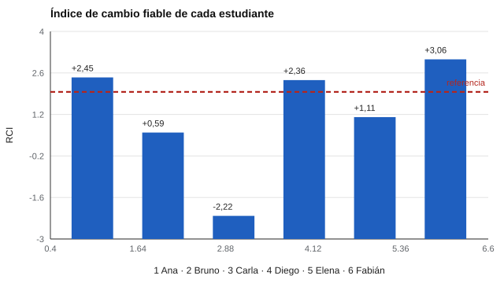

# 198 — Proyecto: tablero de seguimiento longitudinal


<!-- NAV -->
[← 197 — Proyecto: auditoría ética de un instrumento](../197-proyecto-auditoria-etica-de-un-instrumento/README.md) · [📚 Parte 19](../README.md) · [🗺️ Índice 001–200](../../../PROGRAMA.md) · [199 — Proyecto: instrumento original con protocolo… →](../199-proyecto-instrumento-original-con-protocolo-de-validacion/README.md)
<!-- /NAV -->

**Parte 19 — Aplicaciones avanzadas y proyectos integradores** · Nivel avanzado · 5 h · Estado `escrita`
**Pensada para:** quien diseña tableros de seguimiento, y quien es seguido con ellos.
**Prerrequisitos:** clase 175.

> Datos sintéticos. La regresión a la media y los efectos de práctica (clase 175) también explican parte de las variaciones.

## ¿Para qué te sirve esto?

Un tablero de seguimiento muestra cómo evoluciona cada estudiante o paciente. La tentación es el **semáforo**: verde si sube, rojo si baja. Pero entre dos mediciones, la diferencia tiene **más error** que cada medición. Un semáforo convierte ese ruido en veredictos. Este proyecto construye un tablero que muestra **valores, banda de error y criterio**, y marca «cambio» solo cuando supera el cambio mínimo fiable. Con 6 estudiantes sintéticos verás que tres mejoran de verdad, uno empeora y dos **no** tienen cambio fiable aunque su puntaje subió.

## Al terminar esta clase podrás

- Mostrar trayectorias con su banda de error.
- Marcar cambio solo si supera el cambio mínimo fiable.
- Evitar semáforos que conviertan ruido en veredictos.

## La idea en palabras simples

El **índice de cambio fiable** (RCI) divide la diferencia entre dos mediciones por **√2 × EEM** (Jacobson y Truax, 1991). Con desviación 10 y fiabilidad 0,85, EEM = 3,87 y el **cambio mínimo fiable** al 95 % es **10,7 puntos**. Un |RCI| > 1,96 indica cambio fiable. Por debajo de ese umbral, la diferencia es compatible con el ruido de medida.

## Cómo funciona, paso a paso

**1. Calcular** EEM y el cambio mínimo fiable.

**2. Graficar** las cinco mediciones de cada estudiante con su banda de error (±7,6).

**3. Marcar** «cambio fiable» solo si |RCI| > 1,96.

**Ejemplo resuelto.** Una diferencia de +6,1 puntos (RCI +1,11) no se informa como mejora: está dentro del ruido de medida.



*Figura 1.* Cuatro de seis estudiantes superan el umbral de cambio fiable.

## Si construyes el instrumento

- Muestra valores y banda de error, no solo colores.
- Marca cambio con el RCI, no con la dirección.
- Considera práctica y regresión a la media.
- Evita clasificar personas con semáforos.

## Si eres evaluado (o eres familia)

- Un cambio de pocos puntos entre dos mediciones puede ser ruido.
- Pide ver el criterio con que se marca un cambio.
- Un tablero es para conversar sobre el apoyo, no para etiquetar.

## Qué muestra el laboratorio

EEM = 3,87; cambio mínimo fiable (95 %) = 10,7 puntos entre dos mediciones.

| Estudiante | Mediciones | Diferencia | RCI | Resultado |
|---|---|---:|---:|---|
| Ana | 51,6; 50,8; 57,6; 57,3; 65,0 | +13,4 | +2,45 | cambio fiable (+) |
| Bruno | 48,3; 48,6; 48,3; 55,1; 51,5 | +3,2 | +0,59 | sin cambio fiable |
| Carla | 44,7; 43,7; 33,1; 41,5; 32,5 | −12,1 | −2,22 | cambio fiable (−) |
| Diego | 59,7; 61,3; 64,0; 71,3; 72,6 | +12,9 | +2,36 | cambio fiable (+) |
| Elena | 46,6; 42,4; 45,8; 53,4; 52,6 | +6,1 | +1,11 | sin cambio fiable |
| Fabián | 54,2; 62,9; 62,3; 69,4; 70,9 | +16,7 | +3,06 | cambio fiable (+) |

**Análisis.** (1) La diferencia entre dos mediciones tiene un error mayor que cada medición. (2) Hay que superar el cambio mínimo fiable antes de hablar de cambio. (3) Un tablero con semáforos convertiría el ruido en veredictos; este muestra valores, banda y criterio. (4) Datos sintéticos.

## Errores frecuentes

- Ignorar efectos de práctica y regresión a la media.
- Usar colores de semáforo para clasificar personas.
- Marcar cambio por dirección sin considerar el error.
- Interpretar «cambio fiable» como «cambio importante».

## Lo mínimo que debes llevarte

1. La diferencia tiene más error que cada medición.
2. Se marca cambio solo si |RCI| > 1,96.
3. El tablero muestra valores, banda y criterio.
4. Evita semáforos.

## Ejercicios

- **Inicial.** ¿Por qué la diferencia tiene más error que cada medición? *Solución: porque suma el error de las dos mediciones.*
- **Intermedio.** Cambia la fiabilidad a 0,70 y recalcula el cambio mínimo.
- **Avanzado.** Añade un indicador de variabilidad entre mediciones.
- **Aplicación.** Diseña en papel el tablero de un estudiante con cinco mediciones, sin colores de semáforo.

## Glosario

- **EEM:** error estándar de medida.
- **RCI:** índice de cambio fiable.
- **Banda de error:** rango alrededor del puntaje que refleja el error de medida.
- **Semáforo:** clasificación por colores que reduce información.

## Laboratorio

```bash
python classes/part-19-aplicaciones-avanzadas-y-proyectos-integradores/198-proyecto-tablero-de-seguimiento-longitudinal/lab.py
python classes/part-19-aplicaciones-avanzadas-y-proyectos-integradores/figuras.py
```

## Autoevaluación y criterios

1. ¿Qué decisión de este proyecto es la más discutible? 2. ¿Qué evidencia falta? 3. ¿Qué dato no deberías conservar?
Se logra la clase si ejecutas el proyecto, interpretas sus cifras con cautela y declaras sus límites.

## Bibliografía

- Jacobson, N. S., & Truax, P. (1991). Clinical significance: A statistical approach to defining meaningful change in psychotherapy research. *Journal of Consulting and Clinical Psychology*, 59(1), 12-19. ✅ [DOI](https://doi.org/10.1037/0022-006x.59.1.12)
- AERA, APA, & NCME (2014). *Standards for Educational and Psychological Testing*. AERA. 🔎 sin verificar (libro, norma o sitio no hallado en Crossref: comprobar a mano)

Leyenda: ✅ existe en Crossref con título y año coincidentes (enlace al DOI); ⚠️ hay una obra de título parecido con otro año (no se enlaza: comprobar la edición); 🔎 no verificada automáticamente (libros sin DOI, normas y sitios web). Crossref confirma la existencia de la fuente, no que respalde cada afirmación de la clase. Ver [`docs/VERIFICACION_BIBLIOGRAFIA.md`](../../../docs/VERIFICACION_BIBLIOGRAFIA.md).

---

<!-- NAV -->
[← 197 — Proyecto: auditoría ética de un instrumento](../197-proyecto-auditoria-etica-de-un-instrumento/README.md)  
[📚 Parte 19](../README.md) · [🗺️ Índice 001–200](../../../PROGRAMA.md)  
[199 — Proyecto: instrumento original con protocolo… →](../199-proyecto-instrumento-original-con-protocolo-de-validacion/README.md)
<!-- /NAV -->
