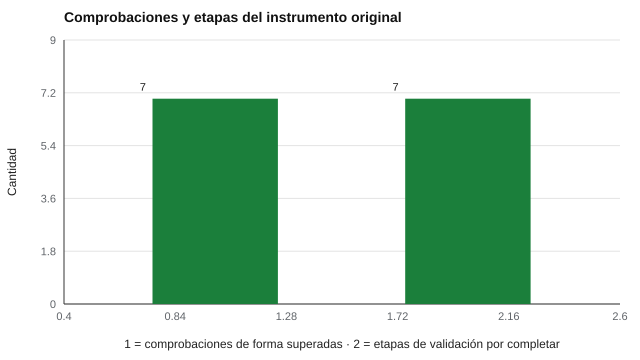

# 199 — Proyecto: instrumento original con protocolo de validación


<!-- NAV -->
[← 198 — Proyecto: tablero de seguimiento longitudinal](../198-proyecto-tablero-de-seguimiento-longitudinal/README.md) · [📚 Parte 19](../README.md) · [🗺️ Índice 001–200](../../../PROGRAMA.md) · [200 — Defensa final y plan de desarrollo profesional →](../200-defensa-final-y-plan-de-desarrollo-profesional/README.md)
<!-- /NAV -->

**Parte 19 — Aplicaciones avanzadas y proyectos integradores** · Nivel avanzado · 5 h · Estado `escrita`
**Pensada para:** quien quiere crear un instrumento propio de forma responsable, y quien evalúa si un instrumento nuevo es serio.
**Prerrequisitos:** clase 193.

> El borrador queda **sin validar**, NO se agrega al catálogo y no se publica como test. Los umbrales del protocolo son convenciones de uso común, no verdades.

## ¿Para qué te sirve esto?

Es la clase más ambiciosa del programa: **crear un instrumento original**. Pero crear no es publicar. El proyecto te hace redactar un banco de 16 ítems originales en dos escalas (PLAN y FOCO, de 8 ítems cada una), **auditar su forma** con reglas automáticas y, sobre todo, **fijar el protocolo de validación y sus umbrales antes de recolectar datos** (preregistro). El resultado es un borrador honesto: pasa las siete comprobaciones de forma, tiene un plan de validación en siete etapas y **sigue sin validar**.

## Al terminar esta clase podrás

- Redactar un banco de ítems originales.
- Auditar su forma con reglas automáticas.
- Fijar el protocolo y los umbrales antes de recolectar datos.

## La idea en palabras simples

Un borrador de instrumento se audita en su **forma**: ítems por escala, claves equilibradas, sin doble pregunta ni dobles negaciones (Boateng et al., 2018). Se acompaña de un **protocolo de validación** con criterios decididos antes de ver los datos (**preregistro**). Las reglas automáticas **no** sustituyen la revisión de expertos ni los estudios con personas (AERA et al., 2014).

## Cómo funciona, paso a paso

**1. Redactar** 16 ítems originales: 8 por escala, 4 positivos y 4 negativos.

**2. Pasar** las siete comprobaciones automáticas de forma.

**3. Fijar** el protocolo de siete etapas con sus umbrales, antes de recolectar datos.

**Ejemplo resuelto.** Los umbrales (I-CVI ≥ 0,78; alfa ≥ 0,70; correlación ítem–resto ≥ 0,20) son convenciones de uso común: se justifican y se registran antes de recolectar.



*Figura 1.* El borrador pasa la forma; las siete etapas de validación siguen pendientes.

## Si construyes el instrumento

- Redacta ítems simples, de una sola idea y de 16 palabras o menos.
- Equilibra las claves positivas y negativas, evitando dobles negaciones.
- Fija umbrales antes de ver los datos y regístralos.
- No publiques el borrador como test.

## Si eres evaluado

- Un instrumento nuevo sin validación no debería usarse para decidir sobre ti.
- Pregunta si hay protocolo, resultados y revisión de expertos.

## Qué muestra el laboratorio

Auditoría automática del banco (todas ok):

| Comprobación | Resultado |
|---|---|
| PLAN: 8 ítems | ok |
| PLAN: claves equilibradas (4/4) | ok |
| FOCO: 8 ítems | ok |
| FOCO: claves equilibradas (4/4) | ok |
| Sin ítems de doble pregunta | ok |
| Ítems de 16 palabras o menos | ok |
| Sin dobles negaciones en ítems invertidos | ok |

Protocolo (criterios fijados antes de recolectar):

| Etapa | Criterio |
|---:|---|
| 1 Revisión de expertos | 6 o más jueces; I-CVI ≥ 0,78 por ítem |
| 2 Entrevistas cognitivas | 10 personas; reescribir lo que se interprete distinto |
| 3 Piloto | n ≥ 200; alfa ≥ 0,70 por escala; eliminar ítems con correlación ítem–resto < 0,20 |
| 4 Estructura | análisis factorial con paralelo: se esperan 2 factores; si no, se revisa la teoría |
| 5 Validez | convergente con una medida abierta y verificada; discriminante con una no relacionada |
| 6 Equidad | DIF por sexo y tipo de colegio; invarianza antes de comparar grupos |
| 7 Decisión | los umbrales se fijan ANTES de ver los datos y se registran |

**Análisis.** (1) Las reglas automáticas detectan problemas de redacción y de equilibrio, no calidad psicométrica. (2) El borrador está SIN VALIDAR. (3) Los umbrales son convenciones, no verdades. (4) Se fijan antes de ver los datos para evitar decidir según el resultado.

## Errores frecuentes

- Publicar el borrador como test.
- Cambiar los umbrales después de ver los datos.
- Creer que pasar las reglas demuestra que los ítems miden el constructo.
- Saltarse la revisión de expertos y las entrevistas cognitivas.

## Lo mínimo que debes llevarte

1. Crear no es publicar.
2. La forma se audita automáticamente; el fondo, con personas.
3. El protocolo y los umbrales se fijan antes.
4. El borrador permanece sin validar hasta completar el protocolo.

## Ejercicios

- **Inicial.** ¿Qué es el preregistro? *Solución: registrar el plan y los criterios antes de ver los datos.*
- **Intermedio.** Añade una regla que detecte ítems con más de un verbo conjugado.
- **Avanzado.** Redacta el plan de análisis para la etapa de estructura.
- **Aplicación.** Redacta 8 ítems originales para una escala que propongas y pásalos por las siete comprobaciones.

## Glosario

- **Ítem original:** ítem escrito por quien construye el instrumento, no copiado.
- **Clave positiva / negativa:** ítem que puntúa en el mismo sentido / invertido.
- **Doble pregunta:** ítem que pregunta por dos cosas a la vez.
- **Preregistro:** declaración pública de plan y umbrales antes del estudio.

## Laboratorio

```bash
python classes/part-19-aplicaciones-avanzadas-y-proyectos-integradores/199-proyecto-instrumento-original-con-protocolo-de-validacion/lab.py
python classes/part-19-aplicaciones-avanzadas-y-proyectos-integradores/figuras.py
```

## Autoevaluación y criterios

1. ¿Qué decisión de este proyecto es la más discutible? 2. ¿Qué evidencia falta? 3. ¿Qué dato no deberías conservar?
Se logra la clase si ejecutas el proyecto, interpretas sus cifras con cautela y declaras sus límites.

## Bibliografía

- AERA, APA, & NCME (2014). *Standards for Educational and Psychological Testing*. AERA. 🔎 sin verificar (libro, norma o sitio no hallado en Crossref: comprobar a mano)
- Boateng, G. O., Neilands, T. B., Frongillo, E. A., Melgar-Quiñonez, H. R., & Young, S. L. (2018). Best practices for developing and validating scales for health, social, and behavioral research: A primer. *Frontiers in Public Health*, 6, 149. ✅ [DOI](https://doi.org/10.3389/fpubh.2018.00149)

Leyenda: ✅ existe en Crossref con título y año coincidentes (enlace al DOI); ⚠️ hay una obra de título parecido con otro año (no se enlaza: comprobar la edición); 🔎 no verificada automáticamente (libros sin DOI, normas y sitios web). Crossref confirma la existencia de la fuente, no que respalde cada afirmación de la clase. Ver [`docs/VERIFICACION_BIBLIOGRAFIA.md`](../../../docs/VERIFICACION_BIBLIOGRAFIA.md).

---

<!-- NAV -->
[← 198 — Proyecto: tablero de seguimiento longitudinal](../198-proyecto-tablero-de-seguimiento-longitudinal/README.md)  
[📚 Parte 19](../README.md) · [🗺️ Índice 001–200](../../../PROGRAMA.md)  
[200 — Defensa final y plan de desarrollo profesional →](../200-defensa-final-y-plan-de-desarrollo-profesional/README.md)
<!-- /NAV -->
