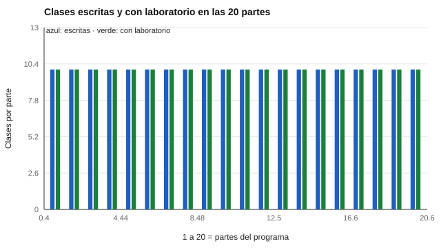

# 200 — Defensa final y plan de desarrollo profesional


<!-- NAV -->
[← 199 — Proyecto: instrumento original con protocolo…](../199-proyecto-instrumento-original-con-protocolo-de-validacion/README.md) · [📚 Parte 19](../README.md) · [🗺️ Índice 001–200](../../../PROGRAMA.md) · (fin del programa)
<!-- /NAV -->

**Parte 19 — Aplicaciones avanzadas y proyectos integradores** · Nivel avanzado · 5 h · Estado `escrita`
**Pensada para:** quien cierra el programa y quiere defender su trabajo con honestidad, y quien evalúa esa defensa.
**Prerrequisitos:** clase 199.

> **Completar el programa no habilita a ejercer.** La práctica profesional exige formación, supervisión y las autorizaciones que fije la normativa vigente. La rúbrica es una guía, no una certificación.

## ¿Para qué te sirve esto?

Terminar un programa de aprendizaje no es lo mismo que estar autorizado a evaluar a personas. La defensa final no mide memoria: mide **criterio y honestidad**. Cada afirmación de tu proyecto debe respaldarse con un laboratorio o una fuente, y debes declarar sus **límites**. Esta clase te da una rúbrica de seis criterios, te muestra cómo el repositorio lee su propio estado (cuántas clases hay escritas y con laboratorio, y qué está planificado) y te ayuda a armar un plan de desarrollo profesional **dentro de la normativa**.

## Al terminar esta clase podrás

- Defender un proyecto con evidencia y límites.
- Leer el estado real del programa en el repositorio.
- Planificar el desarrollo profesional dentro de la normativa.

## La idea en palabras simples

La defensa evalúa criterio y honestidad (AERA et al., 2014; ITC, 2013). La rúbrica tiene seis criterios: **fundamentos, evidencia, equidad, uso responsable, comunicación y reproducibilidad**. El panel del laboratorio lee `curriculum.yaml` y cuenta las clases escritas, las planificadas y las que tienen laboratorio; si hubiera clases planificadas, las mostraría. El plan de desarrollo se propone en **tres horizontes** (corto, mediano y largo plazo) e incluye supervisión.

## Cómo funciona, paso a paso

**1. Elegir** un proyecto (por ejemplo, el 196) y reunir su evidencia.

**2. Defenderlo** contra la rúbrica de seis criterios, declarando sus tres mayores límites.

**3. Escribir** un plan en tres horizontes con supervisión y dentro de la normativa.

**Ejemplo resuelto.** Un estudiante defiende su proyecto 196 respondiendo a la rúbrica (fundamentos, evidencia, equidad, uso responsable, comunicación y reproducibilidad) y propone un plan en tres horizontes.



*Figura 1.* Las 20 partes tienen 10 clases escritas, todas con laboratorio; no hay clases planificadas.

## Si construyes el instrumento

- Presenta cada afirmación con su laboratorio o fuente.
- Declara los límites de tu proyecto sin esperar a que otros los encuentren.
- No presentes el programa como un título habilitante.
- Planifica supervisión y formación continua.

## Si eres evaluado

- Una buena defensa admite lo que no sabe.
- Aprender psicometría no te autoriza a aplicar ni interpretar pruebas con personas: consulta la normativa de tu profesión.

## Qué muestra el laboratorio

El panel del programa (20 partes, 10 clases por parte):

| Medida | Valor |
|---|---:|
| Partes | 20 |
| Clases escritas | 200 |
| Clases planificadas | 0 |
| Clases con laboratorio | 200 |

**Análisis.** (1) El panel lee el estado real desde `curriculum.yaml`, no desde una cifra escrita a mano. (2) «Escrita» describe el estado de las clases; **no** certifica la verificación de las 140 fichas ni la revisión por pares del material (clase 197). (3) Presentar el programa como completo cuando hay clases planificadas sería deshonesto; aquí no las hay. (4) La rúbrica es una guía, no una certificación.

## Errores frecuentes

- Presentar el programa como completo si hay clases planificadas.
- Confundir aprender con estar autorizado a ejercer.
- Defender sin declarar límites.
- Tomar la rúbrica como una certificación.

## Lo mínimo que debes llevarte

1. La defensa evalúa criterio y honestidad.
2. Seis criterios: fundamentos, evidencia, equidad, uso responsable, comunicación y reproducibilidad.
3. El estado del programa se lee del repositorio.
4. Completar el programa no habilita a ejercer.

## Ejercicios

- **Inicial.** ¿Qué criterios incluye la rúbrica? *Solución: fundamentos, evidencia, equidad, uso responsable, comunicación y reproducibilidad.*
- **Intermedio.** Elige tu proyecto y señala sus tres mayores límites.
- **Avanzado.** Escribe tu plan de desarrollo de 18 meses con supervisión.
- **Aplicación.** Prepara una defensa oral de 10 minutos de uno de los proyectos 191–199.

## Glosario

- **Defensa:** exposición razonada de un trabajo ante un panel.
- **Rúbrica:** descripción por criterios y niveles.
- **Plan de desarrollo profesional:** ruta de formación y práctica supervisada.
- **Habilitación profesional:** autorización legal para ejercer una actividad.

## Laboratorio

```bash
python classes/part-19-aplicaciones-avanzadas-y-proyectos-integradores/200-defensa-final-y-plan-de-desarrollo-profesional/lab.py
python classes/part-19-aplicaciones-avanzadas-y-proyectos-integradores/figuras.py
```

## Autoevaluación y criterios

1. ¿Qué decisión de este proyecto es la más discutible? 2. ¿Qué evidencia falta? 3. ¿Qué dato no deberías conservar?
Se logra la clase si ejecutas el proyecto, interpretas sus cifras con cautela y declaras sus límites.

## Bibliografía

- AERA, APA, & NCME (2014). *Standards for Educational and Psychological Testing*. AERA. 🔎 sin verificar (libro, norma o sitio no hallado en Crossref: comprobar a mano)
- International Test Commission (2013). *ITC Guidelines on Test Use*. ITC. 🔎 sin verificar (libro, norma o sitio no hallado en Crossref: comprobar a mano)

Leyenda: ✅ existe en Crossref con título y año coincidentes (enlace al DOI); ⚠️ hay una obra de título parecido con otro año (no se enlaza: comprobar la edición); 🔎 no verificada automáticamente (libros sin DOI, normas y sitios web). Crossref confirma la existencia de la fuente, no que respalde cada afirmación de la clase. Ver [`docs/VERIFICACION_BIBLIOGRAFIA.md`](../../../docs/VERIFICACION_BIBLIOGRAFIA.md).

---

<!-- NAV -->
[← 199 — Proyecto: instrumento original con protocolo…](../199-proyecto-instrumento-original-con-protocolo-de-validacion/README.md)  
[📚 Parte 19](../README.md) · [🗺️ Índice 001–200](../../../PROGRAMA.md)  
(fin del programa)
<!-- /NAV -->
