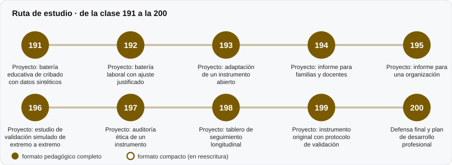

# 🏁 Parte 19 — Aplicaciones avanzadas y proyectos integradores

**Nivel:** avanzado · **Duración estimada:** 5-6 semanas · **Clases:** 10

## De qué trata

Proyectos que integran las partes anteriores con datos sintéticos y decisiones responsables.

## Por qué importa

Integrar es donde se ve si se aprendió: cada proyecto obliga a decidir y a declarar límites.

## Según tu papel

- **Si construyes o aplicas instrumentos:** Cribados, baterías, adaptaciones, informes, auditorías y un borrador de instrumento original.
- **Si eres evaluado o recibes resultados:** Muestra cómo debería ser un buen proceso de evaluación de principio a fin.

## Al terminar esta parte podrás

- Completar un proyecto y defenderlo con evidencia y límites.

## Cómo estudiarla

Al final del recorrido. Elige uno o dos proyectos y hazlos con calma.

## Ruta de estudio

## Clases en orden de estudio

Las clases están numeradas de forma consecutiva (001 a 200) en el orden de estudio: sigue el número.

| Orden | ID | Clase | Qué aprenderás | Formato | Horas |
|---:|---|---|---|---|---:|
| 1 | 191 | [Proyecto: batería educativa de cribado con datos sintéticos](191-proyecto-bateria-educativa-de-cribado-con-datos/README.md) | Diseñar un cribado en dos etapas. | ✅ pedagógico | 4 |
| 2 | 192 | [Proyecto: batería laboral con ajuste justificado](192-proyecto-bateria-laboral-con-ajuste-justificado/README.md) | Traducir un perfil de cargo a requisitos evaluables. | ✅ pedagógico | 4 |
| 3 | 193 | [Proyecto: adaptación de un instrumento abierto](193-proyecto-adaptacion-de-un-instrumento-abierto/README.md) | Ordenar la adaptación en etapas con compuertas. | ✅ pedagógico | 4 |
| 4 | 194 | [Proyecto: informe para familias y docentes](194-proyecto-informe-para-familias-y-docentes/README.md) | Comunicar resultados con incertidumbre. | ✅ pedagógico | 4 |
| 5 | 195 | [Proyecto: informe para una organización](195-proyecto-informe-para-una-organizacion/README.md) | Resumir una encuesta por equipo con intervalos de Wilson. | ✅ pedagógico | 4 |
| 6 | 196 | [Proyecto: estudio de validación simulado de extremo a extremo](196-proyecto-estudio-de-validacion-simulado-de-extremo/README.md) | Integrar diseño, datos, fiabilidad, validez e informe. | ✅ pedagógico | 4 |
| 7 | 197 | [Proyecto: auditoría ética de un instrumento](197-proyecto-auditoria-etica-de-un-instrumento/README.md) | Auditar fichas e instrumentos con una lista de control. | ✅ pedagógico | 4 |
| 8 | 198 | [Proyecto: tablero de seguimiento longitudinal](198-proyecto-tablero-de-seguimiento-longitudinal/README.md) | Mostrar trayectorias con su banda de error. | ✅ pedagógico | 4 |
| 9 | 199 | [Proyecto: instrumento original con protocolo de validación](199-proyecto-instrumento-original-con-protocolo-de-validacion/README.md) | Redactar un banco de ítems originales. | ✅ pedagógico | 4 |
| 10 | 200 | [Defensa final y plan de desarrollo profesional](200-defensa-final-y-plan-de-desarrollo-profesional/README.md) | Defender un proyecto con evidencia y límites. | ✅ pedagógico | 4 |

[← Volver al índice del programa](../../README.md) · [Índice numérico de las 200 clases](../../PROGRAMA.md)
